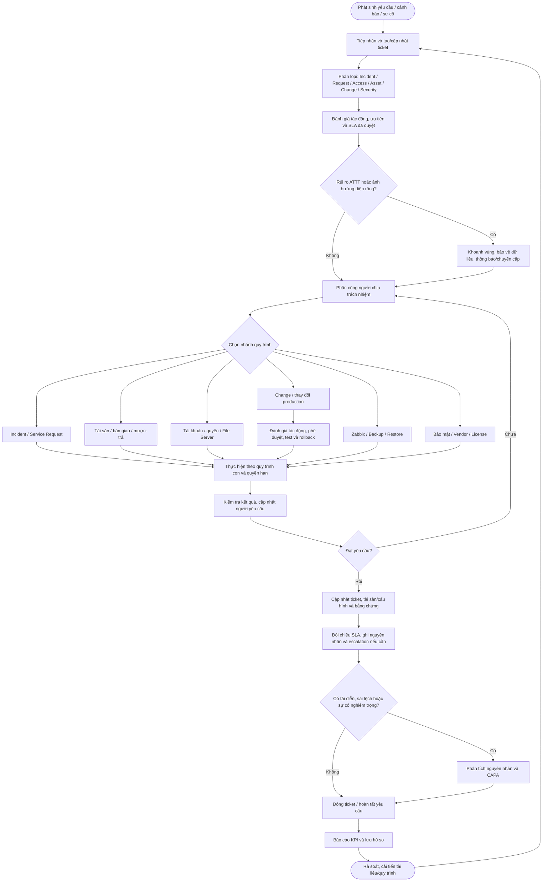

# Lưu đồ tổng thể quản lý dịch vụ CNTT — MSTAR

> Tài liệu điều phối xuyên suốt: tiếp nhận → phân loại → xử lý theo quy trình con → xác minh → đóng hồ sơ → cải tiến. Trạng thái: **DỰ THẢO**, chỉ ban hành sau phê duyệt.

## Lưu đồ xuyên suốt

## Quy trình con được viện dẫn

| Nhánh | Tài liệu |
|---|---|
| Tiếp nhận, phân loại, xử lý và đóng ticket | [03 — Ticket, Incident và Service Request](03-QUY-TRINH-TICKET-INCIDENT-REQUEST.md) |
| Ưu tiên, đo SLA, cảnh báo và chuyển cấp | [02 — SLA nguồn chuẩn và quy tắc tính](02-SLA-NGUON-CHUAN-VA-QUY-TAC-TINH.md) |
| Tài sản, kiểm kê, bàn giao, mượn-trả | [04 — Tài sản và bàn giao](04-QUY-TRINH-TAI-SAN-BAN-GIAO.md) |
| Tài khoản, quyền truy cập và File Server | [05 — Tài khoản, phân quyền và File Server](05-QUY-TRINH-TAI-KHOAN-FILESERVER.md) |
| Change, Zabbix, Backup/Restore | [06 — Change, Zabbix và Backup/Restore](06-QUY-TRINH-CHANGE-MONITOR-BACKUP.md) |
| Sự cố bảo mật, nhà cung cấp, license và báo cáo | [07 — Bảo mật, nhà cung cấp, license và báo cáo](07-QUY-TRINH-BAO-MAT-NHA-CUNG-CAP-VA-BAO-CAO.md) |
| Biểu mẫu vận hành | [09 — Bộ biểu mẫu vận hành ITSM](09-BO-BIEU-MAU-VAN-HANH.md) |
| Kiểm soát tài liệu/hồ sơ | [10 — Kiểm soát tài liệu, hồ sơ và bằng chứng](10-KIEM-SOAT-TAI-LIEU-HO-SO-VA-BANG-CHUNG.md) |
| Đánh giá nội bộ và CAPA | [12 — Đánh giá nội bộ và CAPA](12-QUY-TRINH-DOANH-GIA-NOI-BO-CAPA.md) |
| Tham chiếu ISO | [11 — Đối chiếu ISO/IEC 20000-1 và ISO/IEC 27001](11-DOI-CHIEU-ISO-20000-1-ISO-27001.md) |

## Điểm kiểm soát xuyên suốt

1. Mỗi yêu cầu/cảnh báo phải có mã tham chiếu, người yêu cầu, thời điểm, loại, người xử lý và trạng thái.
2. Chỉ dùng SLA được phê duyệt; không tự suy diễn giá trị thiếu. Ghi mốc thời gian, nguyên nhân vi phạm và lịch sử chuyển cấp.
3. Cấp quyền nhạy cảm và thay đổi hệ thống phải có phê duyệt trước khi thực hiện theo đúng thẩm quyền.
4. Lưu bằng chứng phù hợp: kết quả xử lý, xác nhận, log/cảnh báo, biên bản bàn giao hoặc kết quả backup/restore.
5. Không lưu mật khẩu, token, private key hoặc thông tin xác thực trong ticket, Excel, email thông thường hay repository.
6. Chỉ đóng ticket sau khi kiểm chứng kết quả hoặc ghi rõ giới hạn kiểm tra; vấn đề tái diễn/sai lệch cần xem xét CAPA.
7. Báo cáo SLA/KPI và rà soát định kỳ phải dựa trên dữ liệu có nguồn truy xuất.

## Cần xác nhận trước khi ban hành

- SLA Response Time của nhóm M-Service trong hồ sơ nguồn bị thiếu giá trị.
- Cách tính ngày làm việc/ngày lịch, ngày nghỉ và trường hợp tạm dừng SLA.
- Người nhận escalation, ngưỡng Zabbix, retention backup, RPO/RTO và thời hạn lưu hồ sơ.
- Sơ đồ và cấu hình thực tế phải được đối chiếu trước khi dùng làm hướng dẫn production.

**Lưu ý:** Đối chiếu cấu trúc với tiêu chuẩn ISO không phải tuyên bố MSTAR đã được chứng nhận hoặc đã đáp ứng đầy đủ các yêu cầu.
