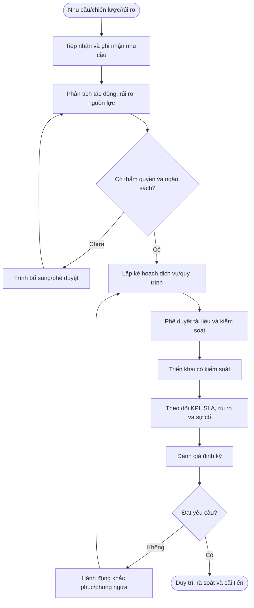

# QUY CHẾ QUẢN LÝ DỊCH VỤ CNTT – MSTAR
**Mã:** MSTAR-ITSM-POL-001 | **Phiên bản:** 1.0-DRAFT | **Hiệu lực:** Chỉ sau khi ký duyệt  
**Chủ tài liệu đề xuất:** IT Lead | **Phê duyệt:** Ban Giám đốc/Người được ủy quyền

## 1. Mục đích
Thiết lập cách tiếp nhận, phân loại, phê duyệt, xử lý, nghiệm thu, lưu hồ sơ và cải tiến các dịch vụ CNTT của MSTAR; giảm yêu cầu thất lạc, gián đoạn dịch vụ, cấp quyền sai, mất dữ liệu và không kiểm soát SLA.

## 2. Phạm vi
Áp dụng cho nhân viên IT, người dùng, quản lý bộ phận, người phụ trách dịch vụ, nhà cung cấp được giao xử lý và các yêu cầu CNTT thuộc phạm vi MSTAR. Phạm vi dịch vụ khách hàng như M-Care/M-Service/Support Online chỉ áp dụng theo hợp đồng, SLA đã duyệt và danh mục dịch vụ được công bố.

## 3. Nguyên tắc bắt buộc
1. Mọi công việc có yêu cầu, sự cố, thay đổi, cấp quyền, tài sản hoặc bảo trì phải được ghi nhận bằng ticket Bitrix hoặc hệ thống thay thế do IT Lead công bố.
2. Điện thoại/Zalo có thể dùng để báo khẩn; người nhận phải tạo/cập nhật ticket ngay khi có thể và ghi thời điểm tiếp nhận thực tế.
3. Không lưu mật khẩu, token, private key, recovery code, dữ liệu cá nhân nhạy cảm không cần thiết trong ticket, bảng tính, email thông thường hoặc repository.
4. Không cấp quyền, mua license, thay đổi production, xóa dữ liệu hoặc bàn giao tài sản khi chưa có phê duyệt bắt buộc.
5. Mọi ticket phải có người chịu trách nhiệm, trạng thái, cập nhật, kết quả, bằng chứng phù hợp và lý do đóng.
6. Không ghi nhận “đã xử lý” nếu chưa có kiểm tra kết quả hoặc nêu rõ giới hạn kiểm tra.
7. Quy trình mới không tự động thay đổi cấu hình đang chạy; mọi triển khai có rủi ro phải qua Change Management.

## 4. Vai trò và trách nhiệm
- **Ban Giám đốc (BGĐ):** phê duyệt chính sách, SLA, rủi ro cao, ngoại lệ, ngân sách và quyết định trong sự cố nghiêm trọng.
- **IT Lead / ITSM Process Owner:** quản lý bộ quy trình; phân công; duyệt theo thẩm quyền; giám sát SLA, rủi ro, năng lực và cải tiến; báo cáo BGĐ.
- **Service Desk/Helpdesk:** ghi nhận và làm rõ ticket; phân loại; cập nhật người yêu cầu; theo dõi hạn; phối hợp nghiệm thu và đóng.
- **IT System/Network/Application:** chẩn đoán, thực hiện, kiểm thử, lưu bằng chứng, cập nhật sơ đồ/runbook/cấu hình và bàn giao vận hành.
- **Quản lý bộ phận/Service Owner/Data Owner:** xác nhận nhu cầu, mức độ tác động, quyền truy cập, dữ liệu và kết quả nghiệp vụ; phê duyệt theo ma trận.
- **Người yêu cầu:** cung cấp thông tin chính xác, phối hợp kiểm thử, bảo quản tài sản và xác nhận kết quả.
- **Nhà cung cấp:** chỉ truy cập trong phạm vi, thời hạn và phương thức được duyệt; chịu giám sát nội bộ; bàn giao kết quả và thu hồi quyền khi xong.

## 5. Hồ sơ và công cụ
- **Bitrix/Ticket:** nguồn theo dõi công việc, SLA, phê duyệt, lịch sử xử lý.
- **Danh mục tài sản:** mã tài sản, serial, vị trí, người sử dụng, trạng thái, bảo hành và lịch sử bàn giao.
- **Danh mục dịch vụ/nhà cung cấp/license:** chủ sở hữu, hợp đồng, gia hạn, người liên hệ, mức độ quan trọng.
- **Zabbix:** trạng thái giám sát, cảnh báo, lịch sử sự kiện.
- **Password vault:** nơi duy nhất được duyệt để lưu bí mật xác thực.
- **Repository tài liệu:** lưu tài liệu quy trình và runbook không chứa bí mật hoặc dữ liệu cá nhân/khách hàng không cần thiết.

## 6. Luồng công việc chuẩn
1. Tiếp nhận và ghi nhận.
2. Kiểm tra thông tin tối thiểu, phân loại loại yêu cầu/dịch vụ/tác động.
3. Xác định mức ưu tiên và SLA đã duyệt.
4. Kiểm tra phê duyệt, quyền, license, tồn kho và điều kiện an toàn.
5. Phân công một người chịu trách nhiệm chính.
6. Thực hiện theo quy trình/runbook được phép; ghi lại hành động trọng yếu.
7. Kiểm thử kết quả, xác nhận với người yêu cầu hoặc kiểm chứng bằng giám sát.
8. Cập nhật tài sản, quyền, cấu hình, sơ đồ hoặc knowledge base nếu có thay đổi.
9. Đóng ticket với mã nguyên nhân/kết quả, thời gian và bằng chứng.
10. Với sự cố nghiêm trọng, lặp lại hoặc vi phạm SLA: phân tích nguyên nhân và theo dõi hành động phòng ngừa.

## 7. Kiểm soát và báo cáo
- Helpdesk rà soát ticket chưa phân công, sắp quá hạn và quá hạn mỗi ngày làm việc.
- IT Lead rà soát SLA, ticket tồn, sự cố lặp lại, thay đổi thất bại, cảnh báo chưa xử lý, tài sản thiếu chủ sở hữu và rủi ro sắp đến hạn theo chu kỳ được duyệt.
- Mỗi hành động khắc phục phải có người phụ trách, ngày đến hạn, trạng thái và bằng chứng hoàn thành.
- Tài liệu thay đổi phải có mã, phiên bản, chủ tài liệu, người duyệt, ngày hiệu lực và lịch sử sửa đổi.

## 8. Những thông số phải được chốt trước khi ban hành
Không tự đặt mặc định: SLA còn thiếu; ngày làm việc/ngày lịch; thời gian tạm dừng SLA; mức độ P1–P4; ngưỡng cảnh báo Zabbix; RPO/RTO; thời gian lưu dữ liệu/log; chu kỳ rà soát quyền; ma trận phê duyệt; lịch trực và kênh liên lạc khẩn. Các thông số này phải được ghi vào phụ lục đã phê duyệt.

## 9. Hiệu lực và ngoại lệ
Chỉ có hiệu lực khi được người có thẩm quyền ký. Ngoại lệ phải có lý do, phạm vi, rủi ro, biện pháp bù trừ, người phê duyệt và ngày hết hạn. IT Lead tổ chức đào tạo, thử nghiệm biểu mẫu và đánh giá sau triển khai.

## 10. Lưu đồ quản trị tổng thể

## 11. Ma trận trách nhiệm tối thiểu (RACI)

R = thực hiện; A = chịu trách nhiệm cuối cùng/phê duyệt; C = tham vấn; I = được thông báo. Tên/chức danh cụ thể phải được MSTAR xác nhận trong ma trận phân quyền.

| Hoạt động | Người yêu cầu/đơn vị | IT Helpdesk/System | IT Lead | Chủ dịch vụ/quản lý | Ban lãnh đạo |
|---|---|---|---|---|---|
| Ghi nhận yêu cầu | R | A/R | I | I | I |
| Xử lý ticket thông thường | C | R | A | I | I |
| Thay đổi rủi ro cao | I | R | C | C | A theo thẩm quyền |
| Cấp quyền dữ liệu nhạy cảm | C | R | C | A | I/C theo phân quyền |
| Phê duyệt chính sách/SLA | C | C | R | C | A |
| Rà soát KPI và cải tiến | C | R | A | C | I |

## 12. Đo lường, bằng chứng và rà soát
- KPI tối thiểu cần báo cáo: số ticket theo loại/trạng thái; tỷ lệ đáp ứng SLA; ticket tồn đọng; sự cố nghiêm trọng; thay đổi thất bại; kết quả backup/restore; tài sản chưa đối soát; quyền truy cập chưa rà soát; license/hợp đồng sắp hết hạn.
- Không đặt mục tiêu số cụ thể nếu chưa có phê duyệt. Định nghĩa công thức, nguồn dữ liệu, kỳ báo cáo, chủ sở hữu chỉ số và ngưỡng cảnh báo trong phụ lục KPI được duyệt.
- Hồ sơ bắt buộc: phiên bản quy trình; biên bản phê duyệt; ticket; biên bản thay đổi; sổ tài sản; nhật ký vận hành; báo cáo SLA; biên bản rà soát và hành động khắc phục.
- Rà soát ít nhất theo chu kỳ do MSTAR phê duyệt và sau sự cố nghiêm trọng, thay đổi lớn hoặc phát hiện kiểm toán.
