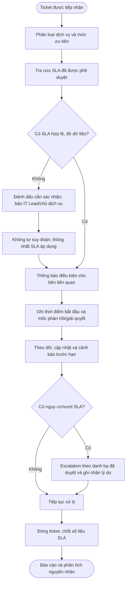

# SLA – NGUỒN CHUẨN, ĐỐI CHIẾU VÀ QUY TẮC TÍNH
**Mã:** MSTAR-ITSM-SLA-001 | **Phiên bản:** 1.0-DRAFT  
**Nguồn nghiệp vụ:** 3.b VANHANH – Quy trình Helpdesk & SLA.docx  
**Cảnh báo:** Bảng này sao chép các giá trị đọc được từ hồ sơ gốc; không có nghĩa là đã xác nhận với cấu hình Bitrix hiện tại.

## 1. Bảng SLA theo hồ sơ gốc

| SLA Standard | Service Template | Response Time trong nguồn | Resolve Time trong nguồn | Ngưỡng báo cáo Response | Ngưỡng báo cáo Resolve | Trạng thái |
|---|---|---:|---:|---|---|---|
| SLA Online | Support Online | 1 giờ | 1 giờ | >4 giờ báo VoTrongHung và NguyenHuuPhong; >8 giờ báo BGĐ | >4 giờ báo VoTrongHung và NguyenHuuPhong; >8 giờ báo BGĐ | Có số liệu trong nguồn |
| SLA M Service | M-Care, M-Service, Khảo sát | **“Hrs” – thiếu số** | 3 giờ | >8 giờ báo VoTrongHung và NguyenHuuPhong; >12 giờ báo BGĐ | >8 giờ báo VoTrongHung và NguyenHuuPhong; >12 giờ báo BGĐ | **Chặn ban hành cho đến khi xác nhận Response Time** |
| SLA Giao nhận | Giao nhận, bàn giao NAS/thiết bị | 8 giờ | 8 giờ | >12 giờ báo VoTrongHung và NguyenHuuPhong; >16 giờ báo BGĐ | >12 giờ báo VoTrongHung và NguyenHuuPhong; >16 giờ báo BGĐ | Có số liệu trong nguồn |
| SLA Sửa chữa | Sửa chữa thiết bị | 3 ngày | 7 ngày | >4 ngày báo VoTrongHung và NguyenHuuPhong; >5 ngày báo BGĐ | >10 ngày báo VoTrongHung và NguyenHuuPhong; >14 ngày báo BGĐ | Cần xác nhận ngày lịch/ngày làm việc |
| SLA Bảo hành | Bảo hành thiết bị | 3 ngày | 20 ngày | >4 ngày báo VoTrongHung và NguyenHuuPhong; >5 ngày báo BGĐ | >20 ngày báo VoTrongHung và NguyenHuuPhong; >25 ngày báo BGĐ | Cần xác nhận ngày lịch/ngày làm việc |
| SLA Internal | Nội bộ, mượn thiết bị | 1 ngày | 5 ngày | >2 ngày báo VoTrongHung và NguyenHuuPhong; >3 ngày báo BGĐ | >6 ngày báo VoTrongHung và NguyenHuuPhong; >7 ngày báo BGĐ | Cần xác nhận ngày lịch/ngày làm việc |

## 2. Giờ làm việc ghi trong nguồn
- Ngày làm việc: thứ Hai đến thứ Bảy.
- Một ngày làm việc: 8 giờ.
- Nguồn quy đổi: 8 giờ = 1 ngày làm việc; 12 giờ = 1,5 ngày làm việc; 16 giờ = 2 ngày làm việc; 24 giờ = 3 ngày làm việc.
- Nguồn không nói rõ ngày lễ, ngày nghỉ, múi giờ, SLA ngoài giờ, thời gian chờ khách hàng/nhà cung cấp hoặc quy tắc pause/resume. Không tự suy diễn các điều kiện này.

## 3. Quy tắc vận hành đề xuất – cần phê duyệt
1. **Response Time** là thời gian từ thời điểm ticket được tiếp nhận hợp lệ đến phản hồi đầu tiên có nội dung hữu ích cho người yêu cầu; email tự động không được tính là phản hồi nếu chưa được phê duyệt là đáp ứng.
2. **Resolve Time** phải được định nghĩa thống nhất: khôi phục dịch vụ/hoàn thành yêu cầu và có kiểm chứng. Chủ dịch vụ cần xác nhận có cho phép trạng thái “Resolved – chờ người dùng xác nhận” hay không.
3. Mọi ticket phải có timestamp tiếp nhận, phản hồi đầu tiên, các lần cập nhật, thời điểm khôi phục/hoàn thành và đóng.
4. Chỉ được tạm dừng SLA với mã lý do được duyệt, ví dụ chờ thông tin người yêu cầu hoặc chờ nhà cung cấp; phải ghi thời điểm bắt đầu/kết thúc chờ. Nếu SLA hợp đồng không cho phép pause thì không pause.
5. Ngưỡng báo cáo trong bảng trên phải được cấu hình/kiểm thử trên Bitrix sau khi đối chiếu người nhận hiện hành. Tên người nhận trong nguồn có thể là dữ liệu cũ; không tự đổi hoặc gửi báo cáo tới địa chỉ chưa xác minh.
6. Không tự động chuyển “ngày” thành ngày lịch hay ngày làm việc khi chưa có quyết định bằng văn bản.

## 4. Quyết định cần ký trước khi ban hành
- Response Time của SLA M Service: __________
- “Days” đối với sửa chữa/bảo hành/nội bộ: ngày lịch / ngày làm việc (chọn một cho từng SLA): __________
- Lịch làm việc, ngày lễ, giờ bắt đầu/kết thúc và múi giờ: __________
- Có/không pause SLA; mã lý do hợp lệ: __________
- Danh sách người nhận cảnh báo và email/chức danh hiện hành: __________
- Ngày kiểm thử cấu hình Bitrix và người nghiệm thu: __________
- Người duyệt / chức danh / ngày ký: __________

## 7. Lưu đồ xác định và theo dõi SLA

## 8. Quy tắc đo lường phải được phê duyệt
1. Định nghĩa riêng **thời gian phản hồi** (thời điểm phản hồi có ý nghĩa đầu tiên) và **thời gian giải quyết** (đáp ứng tiêu chí hoàn tất được định nghĩa).
2. Quy định giờ làm việc, ngày nghỉ, múi giờ, giờ ngoài lịch, thời điểm bắt đầu/dừng/tiếp tục đồng hồ SLA, cách xử lý ticket chờ người dùng/nhà cung cấp và cách xử lý ticket được mở lại.
3. Quy định ticket trùng, ticket chuyển nhóm, sự cố diện rộng và trường hợp phụ thuộc bên thứ ba.
4. Mỗi báo cáo phải nêu kỳ đo, mẫu số, số ticket loại trừ, nguồn dữ liệu và lý do loại trừ.
5. Không coi trạng thái “đã phản hồi” là “đã giải quyết”; không dừng SLA chỉ vì ticket được chuyển nhóm.
6. SLA M-Service có trường Response Time thiếu giá trị trong nguồn gốc: chưa đủ điều kiện áp dụng con số chính thức.
