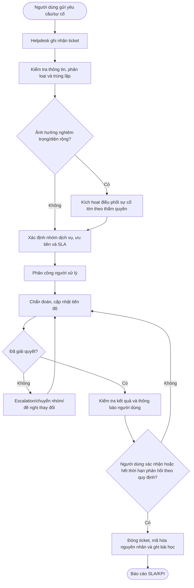

# QUY TRÌNH TICKET, INCIDENT VÀ SERVICE REQUEST
**Mã:** MSTAR-ITSM-PRO-001 | **Phiên bản:** 1.0-DRAFT

## 1. Phân biệt
- **Incident – Sự cố:** gián đoạn hoặc suy giảm dịch vụ đang có.
- **Service Request – Yêu cầu dịch vụ:** yêu cầu chuẩn như cấp thiết bị, tài khoản, quyền, phần mềm hoặc hỗ trợ.
- **Change – Thay đổi:** thay đổi cấu hình/hạ tầng/ứng dụng có thể tác động dịch vụ; xử lý theo quy trình Change riêng.
- **Problem/RCA:** phân tích nguyên nhân gốc của sự cố lặp lại hoặc nghiêm trọng.

## 2. Kênh và tạo ticket
Hồ sơ gốc quy định người dùng có thể tạo ticket Bitrix theo Template; quy trình hiện có cũng nhận thông tin qua Group Zalo/điện thoại rồi lên ticket. Kênh chat/điện thoại không thay thế ticket. Người nhận yêu cầu khẩn phải ghi nhận thời điểm báo ban đầu và tạo/cập nhật ticket ngay khi khả thi.

## 3. Trường bắt buộc
Ticket ID; ngày/giờ nhận; người yêu cầu và đơn vị/khách hàng; kênh tiếp nhận; Request Type/Service Template; mô tả có thể tái hiện; thiết bị/dịch vụ/địa điểm; số người và mức ảnh hưởng; mức ưu tiên theo ma trận được duyệt; người/nhóm xử lý; Response/Resolve SLA; lịch sử cập nhật; phê duyệt nếu có; kết quả và bằng chứng; người xác nhận hoặc lý do không thể xác nhận; mã đóng.

## 4. Quy trình thực hiện
1. **Tiếp nhận:** tạo ticket, kiểm tra trùng lặp, ghi đúng thời điểm và thông tin người liên hệ.
2. **Phân loại:** Incident hay Request; xác định dịch vụ, tài sản, site, tác động, phạm vi khách hàng.
3. **Ưu tiên:** dùng ma trận tác động × khẩn cấp đã được phê duyệt. Nếu chưa có ma trận, không tự đặt P1–P4 làm chính sách chính thức; IT Lead phân loại tạm thời và ghi lý do.
4. **Phản hồi:** thông báo đã tiếp nhận, người phụ trách, bước tiếp theo và thời điểm cập nhật dự kiến.
5. **Chẩn đoán:** thu thập log/screenshot cần thiết; bảo vệ dữ liệu; không yêu cầu người dùng gửi mật khẩu.
6. **Phê duyệt:** nếu cần quyền, mua sắm, thay đổi production hoặc truy cập dữ liệu nhạy cảm, phải lấy phê duyệt theo ma trận.
7. **Xử lý:** thực hiện theo runbook; ghi các thao tác có ảnh hưởng; nếu cần nhà cung cấp, ghi thời gian chuyển giao và đầu mối.
8. **Cập nhật:** báo người yêu cầu khi có thay đổi đáng kể, khi phát sinh rủi ro hoặc có nguy cơ trễ SLA.
9. **Kiểm thử:** kiểm tra dịch vụ/kết quả; ưu tiên xác nhận từ người dùng và/hoặc tín hiệu giám sát.
10. **Đóng:** ghi nguyên nhân, hành động, kết quả, thời gian, bằng chứng, tài sản/cấu hình được cập nhật và xác nhận. Không đóng ticket chỉ vì đã chuyển cho nhà cung cấp.
11. **Sau sự cố:** sự cố lặp lại/nghiêm trọng cần RCA hoặc Problem; lập hành động phòng ngừa, owner và hạn.

## 5. Major Incident – đề xuất cần phê duyệt
Kích hoạt khi dịch vụ trọng yếu ngừng, ảnh hưởng nhiều người/khách hàng, có nghi ngờ xâm nhập/mất dữ liệu hoặc cần quyết định quản lý khẩn. IT Lead chỉ định Incident Lead, kỹ thuật viên, người truyền thông và người ghi timeline. Tập trung khôi phục an toàn trước; không suy đoán nguyên nhân khi chưa có bằng chứng. Mọi cập nhật khách hàng phải theo đầu mối được ủy quyền.

## 6. Đóng ticket và kiểm soát chất lượng
Ticket không đủ thông tin phải trả lại với danh sách thông tin cần bổ sung, không xóa lịch sử. Ticket chờ người yêu cầu/nhà cung cấp phải có trạng thái, người theo dõi và ngày nhắc lại. Quy tắc tự đóng ticket, thời gian chờ xác nhận và thời gian lưu hồ sơ phải được phê duyệt riêng.

## 7. Kiểm tra hằng ngày
Helpdesk rà soát ticket chưa phân công, ticket không cập nhật, ticket sắp/quá hạn, ticket chờ phản hồi, sự cố tái diễn và ticket đóng thiếu bằng chứng. IT Lead xem báo cáo vi phạm SLA và phân công hành động khắc phục.

## 8. Lưu đồ xử lý ticket

## 9. Điểm kiểm soát và bằng chứng
- Không xử lý yêu cầu có ảnh hưởng hệ thống nhưng không có ticket, trừ tình huống khẩn cấp; trường hợp khẩn cấp phải tạo ticket hồi tố ngay khi dịch vụ ổn định.
- Mỗi lần đổi người xử lý, đổi mức ưu tiên, tạm dừng SLA hoặc escalation phải có thời điểm, người thao tác và lý do.
- Ticket phải liên kết tài sản, dịch vụ, change hoặc sự cố bảo mật liên quan nếu có.
- Chỉ đóng ticket khi có kết quả, bằng chứng kiểm tra và thông báo cho người yêu cầu. Cách đóng tự động nếu người dùng không phản hồi phải được quy định riêng.
- Hồ sơ: ticket đầy đủ lịch sử; trao đổi; log/ảnh chụp đã loại bỏ bí mật; kết quả khắc phục; xác nhận người dùng; dữ liệu báo cáo.
- KPI: tỷ lệ phản hồi đúng SLA, tỷ lệ giải quyết đúng SLA, backlog theo tuổi, tỷ lệ mở lại, ticket theo nguyên nhân, sự cố tái diễn. Công thức và mục tiêu phải được phê duyệt.
