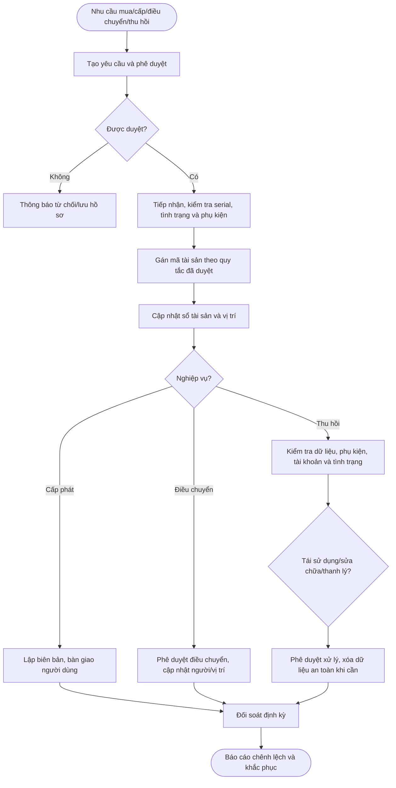

# QUY TRÌNH QUẢN LÝ TÀI SẢN CNTT VÀ BÀN GIAO
**Mã:** MSTAR-ITSM-PRO-002 | **Phiên bản:** 1.0-DRAFT  
**Nguồn:** 1.a, 1.b, 2.b, 2.c

## 1. Quy tắc nguồn cần bảo toàn
Hồ sơ quy hoạch dùng cấu trúc mã: mã công ty + mã vùng (tùy chọn HCM/HN/DN) + mã loại thiết bị + mã người dùng (tùy chọn) + mã phòng (tùy chọn) + số thứ tự. Ví dụ trong nguồn: MSS01 (Mstar Server 01), MSN01 (Mstar NAS 01), MSTV01 (Mstar TV 01). Mã loại thiết bị gồm NAS (N), Server (S), Desktop (D), Laptop (L), Monitor (M), Printer (P), Camera (CA), Recording (RC), Router (RT), Rackmount (RM), Firewall (F), Switch (SW), Wi-Fi (W), Time Recorder (TR), VM, TV, Cabinet (CM), Standee (ST), Accessories (A), UPS (U). Cần đối chiếu danh mục thực tế trước khi áp dụng đồng loạt.
Trạng thái nguồn: Damaged/Hư hỏng; In Store/Lưu kho; In Use/Đã cấp phát. Kho dùng Check-In để thu hồi và Check-Out để xuất/cho mượn.

## 2. Nguyên tắc
- Mỗi tài sản có một mã duy nhất; không tái sử dụng mã của tài sản thanh lý.
- Ghi nhận serial/Service Tag, hãng/model, cấu hình, vị trí, người giữ, bộ phận, tình trạng, ngày mua/nhận, bảo hành, nhà cung cấp và trạng thái.
- Tài khoản/license là tài sản thông tin cần quản lý vòng đời; không ghi bí mật xác thực trong danh mục.
- Không bàn giao/đổi người sử dụng khi chưa cập nhật sổ tài sản và biên bản.
- Thiết bị hỏng, mất, thiếu phụ kiện hoặc không rõ nguồn gốc phải được ghi nhận và báo IT Lead.

## 3. Tiếp nhận tài sản mới
1. Đối chiếu đơn mua/biên bản nhà cung cấp; kiểm tra số lượng, model, serial, phụ kiện và ngoại quan.
2. Kiểm tra kỹ thuật theo checklist phù hợp; ghi kết quả Pass/Fail và lỗi.
3. Cấp mã theo quy tắc đã phê duyệt; gắn nhãn vật lý nếu phù hợp.
4. Ghi sổ tài sản, vị trí lưu kho, bảo hành, hóa đơn/hợp đồng tham chiếu và người quản lý.
5. Nếu là thiết bị mạng/server, thực hiện quy trình Change trước khi đưa vào production.
6. Chỉ chuyển trạng thái In Store khi đã kiểm tra và sẵn sàng cấp phát; tài sản lỗi phải ghi Damaged/quarantine theo quy định nội bộ được duyệt.

## 4. Check-Out/bàn giao
1. Có yêu cầu/ticket và phê duyệt của quản lý bộ phận nếu quy định áp dụng.
2. Kiểm tra tài sản, serial, phụ kiện, tình trạng và dữ liệu có sẵn; xử lý dữ liệu theo quy trình được duyệt.
3. Người giao và nhận kiểm tra thực tế, ký biên bản; ghi ngày giờ, người sử dụng, địa điểm và mục đích.
4. Hướng dẫn sử dụng, bảo mật, báo hỏng/mất và kênh hỗ trợ.
5. Cập nhật sổ tài sản sang In Use, gắn người dùng/bộ phận và liên kết ticket.
6. Không ghi password trong biên bản. Nếu bàn giao quyền quản trị, chuyển qua password vault được duyệt và xác nhận người nhận đã tiếp nhận an toàn.

## 5. Check-In/thu hồi
1. Mở ticket/biên bản thu hồi; xác định tài sản theo mã và serial.
2. Kiểm tra ngoại quan, phụ kiện, tình trạng, dữ liệu công ty và tài khoản còn đăng nhập.
3. Với máy tính: sao lưu dữ liệu công việc theo phê duyệt; thu hồi phiên đăng nhập/token; xóa dữ liệu an toàn trước tái cấp phát theo chính sách được duyệt.
4. Ghi tình trạng, thiếu hụt, hỏng hóc và người xác nhận.
5. Thu hồi quyền truy cập liên quan; cập nhật tài sản In Store/Damaged/đang sửa chữa.
6. Nếu mất/hỏng nghi vấn hoặc có dữ liệu nhạy cảm, kích hoạt quy trình sự cố bảo mật.

## 6. Mượn, đổi, sửa chữa và thanh lý
Mượn tài sản phải có người mượn, thời hạn dự kiến, người duyệt và ngày nhắc trả. Đổi người dùng cần biên bản Check-In rồi Check-Out hoặc giao dịch chuyển chủ sở hữu được lưu dấu. Sửa chữa/bảo hành cần ticket, serial, nhà cung cấp, ngày gửi/nhận và kết quả kiểm tra. Thanh lý chỉ thực hiện khi có phê duyệt của cấp có thẩm quyền, xóa dữ liệu an toàn và chứng từ bàn giao/tiêu hủy.

## 7. Kiểm kê và đối soát
Chu kỳ kiểm kê phải do BGĐ/Finance/IT phê duyệt. Tối thiểu đối soát mã, serial, vị trí, người dùng, tình trạng và license; mọi chênh lệch có ticket, nguyên nhân, người xử lý và hạn hoàn thành. Không tự đặt chu kỳ chính thức khi chưa được phê duyệt.

## 8. Mẫu biên bản tối thiểu
Mã biên bản; ngày giờ; bên giao/nhận; ticket; mã tài sản; loại; hãng/model; serial; cấu hình; phụ kiện; tình trạng; dữ liệu/ứng dụng bàn giao; vị trí; mục đích; xác nhận đã hướng dẫn; chữ ký/xác nhận điện tử; ghi chú; phê duyệt nếu có.

## 8. Lưu đồ vòng đời tài sản

## 9. Đối soát và hồ sơ
- Mỗi tài sản phải có mã duy nhất, serial (nếu có), loại, hãng/model, tình trạng, vị trí, người/bộ phận quản lý, ngày nhận, nguồn mua và trạng thái vòng đời.
- Khi không có serial hoặc thiết bị phụ kiện nhỏ, ghi rõ quy tắc nhận dạng thay thế được phê duyệt.
- Đối soát vật lý với sổ tài sản theo lịch được duyệt; mọi chênh lệch phải có biên bản, người phụ trách và hạn xử lý.
- Khi thu hồi thiết bị có dữ liệu, phải đánh giá sao lưu, quyền truy cập, xóa dữ liệu an toàn và bằng chứng thực hiện theo chính sách; không mặc định chỉ xóa file là đủ.
- Hồ sơ: yêu cầu mua/cấp phát; biên bản giao nhận; sổ tài sản; điều chuyển; sửa chữa/bảo hành; kiểm kê; thanh lý; chứng từ xóa dữ liệu.
- KPI: tỷ lệ tài sản có đủ trường dữ liệu, tỷ lệ kiểm kê khớp, số tài sản không rõ người quản lý, tài sản quá hạn bảo hành/license, thời gian cập nhật sau bàn giao.
