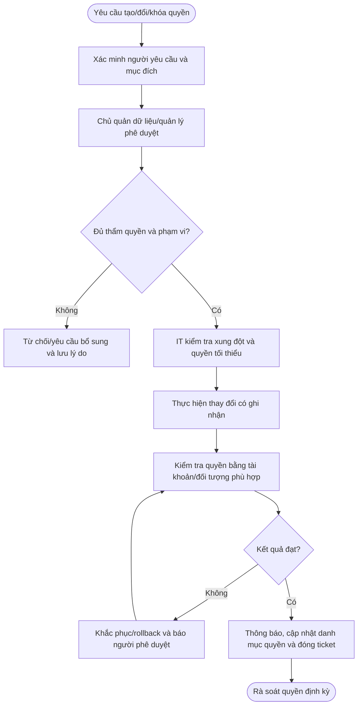

# QUY TRÌNH TÀI KHOẢN, PHÂN QUYỀN VÀ FILE SERVER
**Mã:** MSTAR-ITSM-PRO-003 | **Phiên bản:** 1.0-DRAFT  
**Nguồn:** 2.a Hướng dẫn triển khai File Server

## 1. Cấu trúc và nguyên tắc nguồn
Hồ sơ gốc mô tả tài khoản người dùng và máy tính trong domain; nhóm theo phòng ban; các ổ/thư mục PUBLIC, thư mục phòng ban và thư mục cá nhân. PUBLIC dùng chia sẻ phạm vi công ty; thư mục phòng có khu vực dùng chung nội bộ và thư mục cá nhân riêng. Cấu trúc thư mục được quản trị tập trung; dữ liệu công việc được lưu trên vùng lưu trữ mạng theo quy định.
Tên miền/domain thực tế trong tài liệu còn để trống; phải xác minh trước khi ban hành. Quy tắc tên tài khoản TÊN.HỌ và các chính sách mật khẩu/khóa tài khoản trong tài liệu cũ phải được kiểm tra với AD/IdP hiện hành trước khi áp dụng.

## 2. Cấp tài khoản mới
1. Có yêu cầu chính thức ghi rõ nhân viên, mã nhân sự nếu có, bộ phận, quản lý duyệt, ngày bắt đầu, loại tài khoản và hệ thống cần dùng.
2. IT xác minh danh tính và phê duyệt; chỉ cấp quyền tối thiểu theo vai trò, không sao chép toàn bộ quyền của người khác một cách máy móc.
3. Tạo tài khoản theo chuẩn tên đã được duyệt; bật MFA khi nền tảng và chính sách yêu cầu; đặt phương thức bàn giao mật khẩu tạm an toàn.
4. Thêm nhóm đúng phòng ban; chỉ cấp quyền vào thư mục/service được quản lý phê duyệt.
5. Kiểm thử đăng nhập và quyền đọc/ghi/xóa theo yêu cầu; lưu kết quả trong ticket.
6. Thông báo người dùng về lưu dữ liệu, bảo mật, báo sự cố và kênh hỗ trợ.

## 3. Thay đổi quyền
Mọi thay đổi quyền cần ticket, mục đích nghiệp vụ, tài nguyên cụ thể, mức quyền, thời hạn (nếu tạm thời), người phê duyệt/data owner và người thực hiện. Quyền đặc quyền cần phê duyệt riêng; khi kết thúc thời hạn phải rà soát/thu hồi. Không cấp quyền dựa trên yêu cầu miệng không được xác nhận, trừ quy trình khẩn cấp có hậu kiểm.

## 4. Quy tắc File Server
- **PUBLIC:** dùng dữ liệu chia sẻ chung; trước khi cấp quyền sửa/xóa ở thư mục gốc, data owner và IT phải đánh giá nguy cơ mất dữ liệu, nhóm quyền, audit và khả năng khôi phục. Hồ sơ gốc mô tả quyền sửa/xóa rộng ở root; không triển khai lại nguyên trạng nếu chưa có đánh giá và phê duyệt.
- **Thư mục phòng ban:** quyền theo nhóm phòng ban; người ngoài phòng chỉ có quyền đọc hoặc quyền khác khi data owner phê duyệt.
- **Thư mục cá nhân:** chỉ người dùng và quản trị viên được ủy quyền theo chính sách mới; truy cập quản trị phải có mục đích và audit.
- **Thư mục hệ thống:** người dùng không tự ý thay đổi cấu trúc chuẩn; mọi thay đổi phải có ticket/change.
- Không dùng chia sẻ cục bộ trên PC làm kho chính thức nếu chính sách MSTAR yêu cầu lưu trên vùng mạng; ngoại lệ cần phê duyệt.
- Chỉ lưu dữ liệu công việc theo chính sách; loại file được phép/chặn cần được rà soát theo nhu cầu nghiệp vụ và biện pháp an ninh, không chỉ dựa vào phần mở rộng file.

## 5. Thu hồi tài khoản khi nghỉ việc/chuyển vị trí
HR/Quản lý phải thông báo theo thời điểm hiệu lực; IT tạo ticket có checklist hệ thống. Đến thời điểm được duyệt: khóa/thu hồi đăng nhập, phiên/token, VPN, email, cloud, VPN, nhóm File Server, quyền quản trị và tài khoản nhà cung cấp; chuyển giao dữ liệu công việc cho data owner; thu hồi tài sản; ghi lại bằng chứng. Không xóa mailbox/tệp ngay khi chưa có phê duyệt retention/legal hold.

## 6. Rà soát quyền định kỳ
Data owner/Quản lý xác nhận người còn cần truy cập, quyền phù hợp, tài khoản không hoạt động và quyền đặc quyền. Chu kỳ phải được phê duyệt; phát hiện quyền không còn cần thiết phải có ticket thu hồi và bằng chứng. Báo cáo ngoại lệ cho IT Lead.

## 7. Kiểm tra sau thay đổi
Kiểm thử bằng tài khoản người dùng phù hợp: quyền được phép, quyền bị từ chối, truy cập ngoài phạm vi, truy cập từ máy/địa điểm theo chính sách. Lưu ảnh/log đã che thông tin nhạy cảm và cập nhật sơ đồ quyền nếu thay đổi lớn.

## 8. Lưu đồ quản lý quyền truy cập

## 9. Kiểm soát an toàn thông tin
- Tách biệt người yêu cầu, người phê duyệt và người thực hiện khi khả thi; trường hợp nhân sự ít phải có kiểm tra bù và lưu dấu vết.
- Cấp quyền theo nguyên tắc tối thiểu cần thiết; quyền quản trị phải có lý do, thời hạn và phê duyệt riêng.
- Quyền nhóm, ACL thư mục và quyền chia sẻ phải được lập danh mục; quyền ghi/xóa tại thư mục gốc dùng chung cần được đánh giá rủi ro, không kế thừa máy móc từ hướng dẫn cũ.
- Với nhân sự nghỉ việc/chuyển bộ phận: tiếp nhận thông báo chính thức, xác định thời điểm hiệu lực, khóa/điều chỉnh tài khoản, thu hồi phiên/token/VPN khi áp dụng, bàn giao dữ liệu công việc theo phê duyệt và lưu bằng chứng.
- Không gửi mật khẩu qua ticket/email không bảo vệ; không ghi mật khẩu, MFA seed, recovery code, private key hay token vào tài liệu hoặc Git.
- Rà soát quyền theo chu kỳ được duyệt và khi đổi vai trò; xác nhận của chủ sở hữu dữ liệu phải được lưu.
- Hồ sơ: yêu cầu/phê duyệt; nhật ký thay đổi; kết quả kiểm thử; danh sách nhóm/ACL; biên bản rà soát; checklist offboarding.
