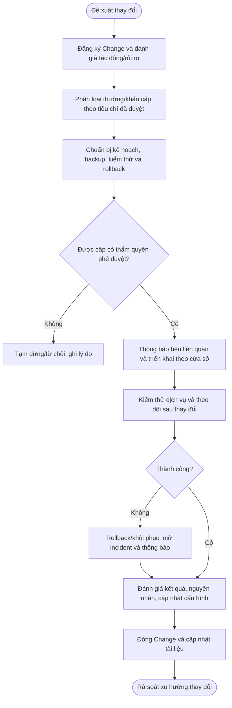
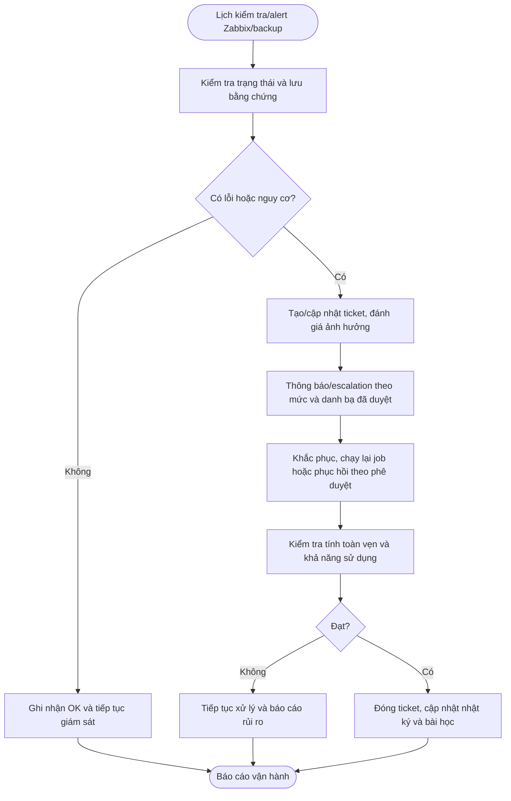

# QUY TRÌNH THAY ĐỔI, GIÁM SÁT VÀ SAO LƯU/KHÔI PHỤC
**Mã:** MSTAR-ITSM-PRO-004 | **Phiên bản:** 1.0-DRAFT  
**Nguồn:** 3.a Daily checklist; 4.a Monitoring With ZABBIX; 2.e Network Diagram Template

## A. Quản lý thay đổi
### A1. Phạm vi
Áp dụng với thay đổi cấu hình mạng/firewall, server/NAS, AD/DNS/DHCP, File Server/ACL, Zabbix, ứng dụng, database, backup, tài khoản đặc quyền, nâng cấp, cập nhật và thay đổi có thể gây gián đoạn.

### A2. Hồ sơ Change tối thiểu
Change ID; người đề nghị; mục tiêu/lý do; hệ thống và dịch vụ ảnh hưởng; phân loại rủi ro; đánh giá tác động; thời gian triển khai; người thực hiện; phê duyệt; bản sao lưu/cấu hình trước thay đổi; kế hoạch kiểm thử; kế hoạch rollback; thông báo; kết quả; cập nhật tài liệu và hậu kiểm.

### A3. Các bước
1. Tạo Change ticket trước khi làm.
2. Đánh giá ảnh hưởng, phụ thuộc, bảo mật, khả năng gián đoạn và phương án phục hồi.
3. Lấy phê duyệt theo ma trận. Thay đổi khẩn cấp phải ghi lý do, người chấp thuận và thực hiện hậu kiểm trong thời hạn được phê duyệt.
4. Xác nhận backup/backup cấu hình có thể dùng; kiểm tra rollback.
5. Thông báo người dùng/đầu mối bị ảnh hưởng.
6. Triển khai trong cửa sổ được duyệt; ghi timestamp và hành động chính.
7. Kiểm thử dịch vụ, log và giám sát; nếu thất bại/ảnh hưởng vượt ngưỡng thì rollback.
8. Cập nhật sơ đồ mạng, inventory, runbook, tài sản và knowledge base.
9. Đóng Change sau hậu kiểm, lưu bằng chứng và ghi bài học kinh nghiệm.

## B. Giám sát Zabbix
### B1. Phạm vi gợi ý theo hồ sơ vận hành
Daily checklist hiện liệt kê DC-Primary, File Server, Backup Center, DVA/Camera, Host/VM, Virtual DSM; dịch vụ AD, DNS, DHCP, Email Server/license; router chính, switch trung tâm, Wi-Fi controller và hạ tầng phòng máy. Danh sách này là điểm khởi đầu, phải đối chiếu inventory và dịch vụ đang chạy để tránh thiếu host.
### B2. Quy trình thêm host
1. Có ticket/change nếu thay đổi production; ghi hostname, IP/DNS, site, owner, dịch vụ, mức độ quan trọng và phương thức giám sát.
2. Chọn Zabbix Agent hoặc SNMP theo nền tảng và chính sách; không ghi community string/secret vào tài liệu công khai.
3. Gán template phù hợp; kiểm tra connectivity, item data, latest data và trigger.
4. Tạo/kiểm tra tuyến thông báo, người nhận và escalation; thử cảnh báo có kiểm soát.
5. Cập nhật Monitoring Host Register và sơ đồ.
6. Xác nhận cảnh báo thử được nhận và đóng ticket.

### B3. Xử lý cảnh báo
1. Ghi nhận alert/event và timestamp.
2. Xác định host, dịch vụ, ảnh hưởng và cảnh báo liên quan.
3. Tạo/liên kết ticket; ưu tiên theo ma trận đã duyệt.
4. Kiểm tra log, tài nguyên, mạng, phụ thuộc và thay đổi gần nhất.
5. Khắc phục an toàn; nếu cần thay đổi production, áp dụng Change.
6. Xác nhận phục hồi bằng dữ liệu Zabbix và kiểm tra dịch vụ.
7. Ghi nguyên nhân, hành động và ngăn tái diễn.
Ngưỡng CPU/RAM/Disk, thời gian acknowledge, lịch trực và người nhận ngoài giờ chưa được 10 hồ sơ quy định thống nhất; phải phê duyệt theo từng dịch vụ, không đặt ngưỡng chung không căn cứ.

## C. Sao lưu và khôi phục
### C1. Nguyên tắc
Daily checklist nguồn có kiểm tra NAS HDD/Volume/Log, backup Domain Controller, Wi-Fi Controller, máy chủ kế toán và database kế toán. Đây là các hạng mục được nêu trong nguồn, không chứng minh rằng mọi backup hiện đang chạy hoặc có thể restore.
### C2. Kiểm tra backup hằng ngày
- Xác nhận job chạy theo lịch, trạng thái thành công/thất bại, thời điểm gần nhất và dung lượng.
- Kiểm tra dung lượng repository, trạng thái HDD/volume, log, lỗi phần cứng và cảnh báo.
- Nếu thất bại: tạo ticket, xác định dịch vụ/dữ liệu ảnh hưởng, người xử lý, chạy lại khi an toàn và kiểm tra kết quả.
- Bảo vệ backup khỏi xóa/ghi đè trái phép; quyền quản trị backup tách biệt khi có khả năng.
### C3. Restore test
1. Có yêu cầu/phê duyệt; xác định dữ liệu, phạm vi, môi trường khôi phục và rủi ro.
2. Xác nhận bản backup và thời điểm dữ liệu.
3. Khôi phục vào môi trường an toàn phù hợp, không ghi đè production khi chưa được duyệt.
4. Kiểm tra tính toàn vẹn, quyền truy cập và khả năng sử dụng của chủ dữ liệu.
5. Ghi thời gian bắt đầu/kết thúc, dữ liệu khôi phục, kết quả, lỗi và thời gian thực tế.
6. Dọn dữ liệu thử theo quy định, đóng ticket và lập hành động khắc phục.
### C4. RPO/RTO
RPO/RTO không có số liệu chuẩn trong 10 hồ sơ. Chủ dịch vụ/BGĐ phải xác định theo mức độ quan trọng, hợp đồng và khả năng hạ tầng; không công bố cam kết khôi phục trước khi thử nghiệm chứng minh được.

## 8. Lưu đồ quản lý thay đổi

## 9. Lưu đồ kiểm tra backup/restore và giám sát

## 10. Kiểm soát và hồ sơ
- Change phải có mã, lý do, phạm vi, đánh giá rủi ro, người phê duyệt, lịch triển khai, kế hoạch kiểm thử và rollback, kết quả và thông tin liên quan.
- Thay đổi khẩn cấp cần quy trình phê duyệt khẩn cấp riêng, nhật ký đầy đủ và rà soát sau triển khai; không dùng nhãn “khẩn cấp” để bỏ qua kiểm soát thông thường.
- Với backup: theo dõi job thành công/thất bại, dung lượng, thời gian lưu, quyền truy cập và tính tách biệt của bản sao; backup thành công không thay thế thử restore.
- RPO/RTO, retention, lịch restore thử, ngưỡng Zabbix, severity và người nhận alert là thông số cần chủ hệ thống/cấp có thẩm quyền phê duyệt.
- Hồ sơ: Change Request; log triển khai; kết quả test; biên bản rollback; nhật ký backup; biên bản restore; cấu hình giám sát; ticket và báo cáo sau sự cố.
