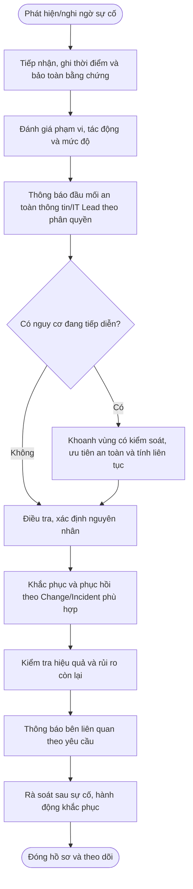
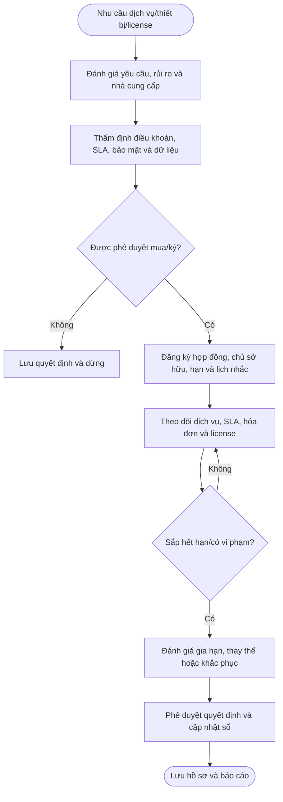

# QUY TRÌNH BẢO MẬT, NHÀ CUNG CẤP, LICENSE VÀ BÁO CÁO
**Mã:** MSTAR-ITSM-PRO-005 | **Phiên bản:** 1.0-DRAFT

## A. Sự cố bảo mật
### A1. Dấu hiệu kích hoạt
Nghi ngờ tài khoản bị chiếm, malware/ransomware, lộ dữ liệu, truy cập bất thường, mất thiết bị có dữ liệu, thay đổi cấu hình trái phép, lộ secret, hoặc nhà cung cấp truy cập ngoài phạm vi.
### A2. Thực hiện
1. Tạo ticket bảo mật với quyền hạn chế; chỉ chia sẻ thông tin cho người cần biết.
2. Ghi thời điểm, người phát hiện, hệ thống, dấu hiệu và bằng chứng; không tự ý xóa log hoặc tắt thiết bị nếu có thể làm mất bằng chứng.
3. Thông báo ngay IT Lead và đầu mối quản lý được chỉ định; trường hợp nghiêm trọng kích hoạt kênh sự cố khẩn cấp đã duyệt.
4. Cô lập/thu hồi phiên hoặc tài khoản khi được người có thẩm quyền chỉ đạo; ưu tiên ngăn lan rộng nhưng bảo toàn bằng chứng.
5. Đánh giá phạm vi ảnh hưởng, dữ liệu, tài khoản, thiết bị và bên thứ ba.
6. Khôi phục theo Change/Restore được duyệt; xác minh sạch và giám sát tăng cường.
7. Lập báo cáo sau sự cố: timeline, tác động, nguyên nhân đã chứng minh, hành động, thông báo, bài học và việc cần làm.
8. Không tự đưa ra tuyên bố pháp lý/khách hàng/công chúng; đầu mối được ủy quyền chịu trách nhiệm truyền thông.

## B. Nhà cung cấp và license
1. Mỗi dịch vụ/nhà cung cấp có hồ sơ: tên pháp nhân, dịch vụ, owner nội bộ, đầu mối hỗ trợ, hợp đồng/PO, ngày bắt đầu/kết thúc, SLA, gia hạn, chi phí, dữ liệu xử lý, quyền truy cập và rủi ro.
2. Trước khi cấp quyền nhà cung cấp: ticket, phê duyệt owner, phạm vi, tài khoản cá nhân nếu có thể, MFA, thời hạn, kênh truy cập được duyệt và giám sát.
3. Không chia sẻ tài khoản quản trị chung nếu có phương án tài khoản cá nhân; nếu bắt buộc phải dùng tài khoản chung, ghi rõ lý do, kho bí mật, người được phép và lịch thay đổi bí mật.
4. Sau công việc: xác nhận kết quả, thu hồi quyền/phiên, nhận lại cấu hình/tài liệu, kiểm tra thay đổi và cập nhật register.
5. Theo dõi license: số lượng mua, số đang dùng, người sở hữu, ngày gia hạn, bằng chứng mua và điều kiện chuyển nhượng. Không tự ý cài phần mềm chưa có quyền sử dụng.
6. Cảnh báo gia hạn cần được thiết lập sau khi xác minh ngày hết hạn và người nhận; không dùng danh mục trống như bằng chứng đã có theo dõi.

## C. Daily checklist và báo cáo
### C1. Mỗi ngày làm việc
- Hệ thống/VM và server trọng yếu: trạng thái, tài nguyên, event/log lỗi.
- NAS: HDD, volume, dung lượng, log và cảnh báo.
- Backup: job, lỗi, lần chạy gần nhất; các workload được nêu trong checklist gốc gồm DC, Wi-Fi controller, máy chủ/database kế toán.
- Dịch vụ AD/DNS/DHCP, Email Server và license.
- Router chính, converter quang, switch trung tâm, port LAN, Wi-Fi controller và tín hiệu.
- Phòng máy: nguồn, nhiệt độ/môi trường và cảnh báo hiện có theo khả năng thiết bị.
- Zabbix: alert chưa xử lý, host mất giám sát và thông báo lỗi.
### C2. Ghi nhận kết quả
Mỗi dòng phải có ngày/giờ, người kiểm tra, trạng thái Pass/Fail/N/A, số đo khi có, bằng chứng/log, ticket liên kết, mức độ, người xử lý và hạn. Không dùng dấu X đơn lẻ làm bằng chứng hoàn tất.
### C3. Báo cáo quản lý
Tổng hợp ticket mới/tồn/quá hạn, SLA đạt/trượt, sự cố nghiêm trọng, thay đổi thất bại, backup fail/restore test, cảnh báo chưa xử lý, tài sản chênh lệch, license/contract sắp hết hạn và hành động quá hạn. Chu kỳ báo cáo và KPI chính thức phải được BGĐ/IT Lead phê duyệt.

## 8. Lưu đồ xử lý sự cố an toàn thông tin

## 9. Lưu đồ quản lý nhà cung cấp/license

## 10. Bằng chứng và chỉ số
- Sự cố bảo mật phải lưu dòng thời gian, hệ thống ảnh hưởng, người nhận thông báo, quyết định khoanh vùng, bằng chứng, nguyên nhân, hành động khắc phục và bài học. Hạn chế truy cập hồ sơ theo mức nhạy cảm.
- Đối với nhà cung cấp, đánh giá quyền truy cập từ xa, dữ liệu được xử lý, điều khoản bảo mật, thông báo sự cố, hoàn trả/xóa dữ liệu khi kết thúc hợp đồng và phụ thuộc nhà cung cấp.
- Theo dõi ngày hết hạn, chủ sở hữu, số lượng/phạm vi license, kênh hỗ trợ, SLA hợp đồng và kế hoạch gia hạn; không lưu secret hoặc license key đầy đủ trong sổ dùng chung.
- KPI: số sự cố bảo mật, thời gian phát hiện/khoanh vùng/khôi phục, hành động khắc phục quá hạn, hợp đồng/license sắp hết hạn, sự cố nhà cung cấp và báo cáo vận hành đúng hạn.
- Hồ sơ: incident security; bằng chứng được kiểm soát; biên bản đánh giá; hồ sơ nhà cung cấp; hợp đồng; sổ license; biên bản đánh giá hiệu năng và hành động khắc phục.
