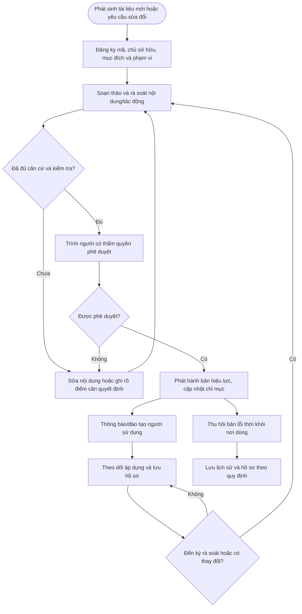

# QUY TRÌNH KIỂM SOÁT TÀI LIỆU, HỒ SƠ VÀ BẰNG CHỨNG ITSM — MSTAR

**Mã tài liệu:** MSTAR-ITSM-PRO-DOC-001  
**Phiên bản:** 0.1-DRAFT  
**Chủ sở hữu đề xuất:** IT Lead  
**Phê duyệt:** Ban Giám đốc/Người được ủy quyền  
**Hiệu lực:** Sau khi phê duyệt và công bố

## 1. Mục đích và phạm vi
Đảm bảo tài liệu, biểu mẫu, nhật ký và bằng chứng liên quan ITSM được nhận diện, rà soát, phê duyệt, phát hành, truy cập, cập nhật, lưu trữ và hủy theo kiểm soát. Áp dụng cho quy trình ITSM, runbook, biểu mẫu, register, báo cáo SLA/KPI, hồ sơ ticket/change/access, backup/restore, monitoring, nhà cung cấp và CAPA.

## 2. Nguyên tắc
1. Chỉ bản đã phê duyệt và còn hiệu lực mới được dùng làm căn cứ vận hành chính thức.
2. Mỗi tài liệu phải có mã, tên, phiên bản, trạng thái, chủ sở hữu, người rà soát/phê duyệt, ngày hiệu lực và ngày rà soát dự kiến.
3. Thay đổi tài liệu phải có lý do, người đề xuất, rà soát tác động và lịch sử sửa đổi.
4. Hồ sơ vận hành phải truy xuất được theo mã ticket/công việc, ngày, dịch vụ và chủ sở hữu.
5. Phân quyền truy cập theo nhu cầu công việc; bảo vệ dữ liệu cá nhân, dữ liệu khách hàng và bằng chứng sự cố.
6. Không lưu mật khẩu, token, private key, recovery code hay bí mật xác thực trong GitHub, Excel, ticket, email thông thường hoặc biên bản. Dùng kho bí mật được MSTAR phê duyệt.
7. Thời hạn lưu hồ sơ phải theo chính sách đã duyệt, hợp đồng và yêu cầu pháp luật áp dụng; không tự đặt thời hạn khi chưa có quyết định.

## 3. Quy trình

## 4. Trách nhiệm
- **Người soạn/chủ tài liệu:** bảo đảm nội dung đúng nguồn, cập nhật theo thay đổi, cung cấp lịch sử sửa đổi.
- **Người rà soát chuyên môn:** kiểm tra tính đúng đắn, khả thi, rủi ro, liên kết và tính nhất quán với tài liệu liên quan.
- **Người phê duyệt:** xác nhận phạm vi, nguồn lực, quyền hạn, ngoại lệ và ngày hiệu lực.
- **Quản trị kho tài liệu:** duy trì chỉ mục, quyền truy cập, phiên bản phát hành và trạng thái tài liệu.
- **Người sử dụng:** kiểm tra trạng thái/phiên bản trước khi áp dụng; không tự thay đổi tài liệu đã ban hành.
- Một người có thể kiêm nhiệm khi được phân công, nhưng việc phê duyệt phải đúng thẩm quyền; nên tách người thực hiện và người kiểm tra đối với tài liệu/quy trình rủi ro cao.

## 5. Quy tắc đặt mã và phiên bản
- Mã tài liệu phải duy nhất; định dạng cụ thể do MSTAR phê duyệt, ví dụ `MSTAR-ITSM-PRO-XXX`, `MSTAR-ITSM-FRM-XXX`, `MSTAR-ITSM-REG-XXX`.
- Bản soạn thảo phải ghi rõ `DRAFT` hoặc `CHỜ PHÊ DUYỆT`; không đặt ngày hiệu lực giả định.
- Khi sửa đổi, tăng phiên bản và ghi người/ngày/nội dung thay đổi. Chỉ phát hành phiên bản mới sau phê duyệt.
- Tài liệu lỗi thời phải đánh dấu `OBSOLETE`/hết hiệu lực và loại khỏi vị trí dùng hiện hành; giữ bản lưu để truy vết khi cần.

## 6. Kiểm soát hồ sơ và bằng chứng
Tối thiểu ghi nhận loại hồ sơ, mã/tham chiếu, ngày tạo, người chịu trách nhiệm, nơi lưu, quyền truy cập, thời hạn lưu theo chính sách được duyệt và trạng thái hủy. Tùy loại hồ sơ, bằng chứng có thể gồm ticket, phê duyệt, log, ảnh chụp cấu hình không chứa bí mật, biên bản bàn giao, kết quả kiểm thử, báo cáo Zabbix, log backup/restore, CAPA và biên bản rà soát.

Khi có sự cố an toàn thông tin hoặc yêu cầu bảo toàn bằng chứng, không tự ý chỉnh sửa/xóa bản gốc; giới hạn quyền truy cập, ghi nhận quá trình bàn giao và chuyển theo quy trình ứng phó sự cố.

## 7. Danh mục kiểm soát tối thiểu
| Trường | Yêu cầu |
|---|---|
| Mã tài liệu/hồ sơ | Duy nhất, tra cứu được |
| Tên và loại | Quy trình, hướng dẫn, biểu mẫu, register, ticket, log hoặc báo cáo |
| Chủ sở hữu | Cá nhân/vai trò được giao |
| Phiên bản/trạng thái | Dự thảo, chờ duyệt, hiệu lực, lỗi thời |
| Người soạn/rà soát/duyệt | Đủ theo thẩm quyền |
| Ngày ban hành/hiệu lực/rà soát | Ghi khi đã xác định; không tự suy diễn |
| Nơi lưu | Kho tài liệu hoặc hệ thống nghiệp vụ được duyệt |
| Phân loại và quyền truy cập | Theo độ nhạy và nhu cầu công việc |
| Thời hạn lưu/hủy | Theo chính sách đã duyệt |
| Liên kết/tài liệu liên quan | Kiểm tra tồn tại và đúng phiên bản |

## 8. Rà soát và chỉ số đề xuất
Rà soát tối thiểu khi có thay đổi hệ thống/quy trình, sự cố, audit, thay đổi luật/hợp đồng hoặc đến kỳ rà soát đã duyệt. KPI đề xuất: tỷ lệ tài liệu hiệu lực có đủ metadata; tỷ lệ rà soát đúng hạn; số tài liệu lỗi thời còn tại điểm sử dụng; tỷ lệ hồ sơ mẫu truy xuất được. Mục tiêu KPI và chu kỳ phải được phê duyệt.

## 9. Biểu mẫu đăng ký tài liệu
| Mã | Tên | Chủ sở hữu | Phiên bản | Trạng thái | Người duyệt | Ngày hiệu lực | Ngày rà soát | Nơi lưu |
|---|---|---|---|---|---|---|---|---|

## 10. Điểm cần phê duyệt trước ban hành
- Kho lưu trữ chính thức và chủ sở hữu quản lý.
- Phân loại thông tin và ma trận quyền truy cập.
- Thời hạn lưu từng loại hồ sơ và phương thức hủy.
- Chu kỳ rà soát, quy tắc mã tài liệu/phiên bản và thẩm quyền phê duyệt.
- Quy tắc bảo toàn bằng chứng sự cố và phối hợp với bộ phận pháp chế/nhân sự khi áp dụng.

## 11. Lịch sử sửa đổi
| Phiên bản | Ngày | Nội dung | Soạn thảo | Rà soát | Phê duyệt |
|---|---|---|---|---|---|
| 0.1-DRAFT | 2026-10-24 | Soạn bổ sung quy trình kiểm soát tài liệu, hồ sơ và bằng chứng | | | |
