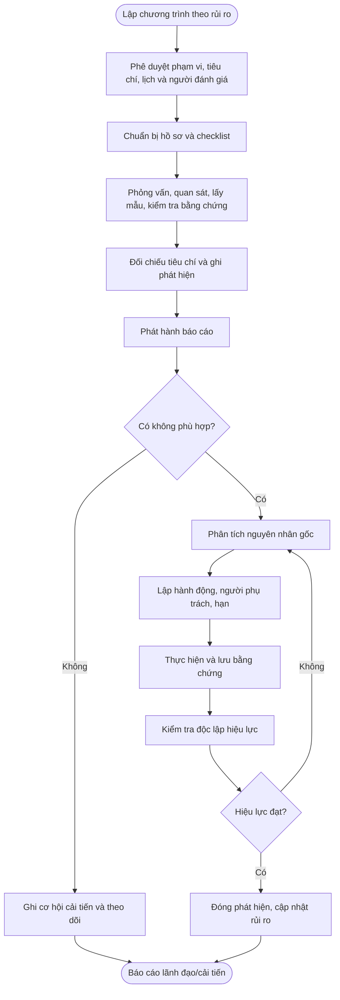

# QUY TRÌNH ĐÁNH GIÁ NỘI BỘ VÀ HÀNH ĐỘNG KHẮC PHỤC

**Mã:** MSTAR-ITSM-PRO-007 | **Phiên bản:** 0.1-DRAFT | **Trạng thái:** Chờ phê duyệt.

## 1. Mục đích/phạm vi
Quy định việc lập chương trình đánh giá nội bộ, thu thập bằng chứng, ghi nhận phát hiện, xử lý nguyên nhân và xác minh hiệu lực đối với quy trình ITSM và các kiểm soát ATTT trong phạm vi được phê duyệt.

## 2. Nguyên tắc
- Đánh giá theo tiêu chí đã xác định, bằng chứng khách quan và mẫu có thể truy xuất.
- Người đánh giá phải có năng lực; tránh đánh giá công việc do chính mình thực hiện nếu có thể bố trí độc lập.
- Phân biệt không phù hợp, quan sát/cơ hội cải tiến và rủi ro.
- Không đóng phát hiện chỉ vì đã sửa một trường hợp; cần xem xét nguyên nhân và xác minh ngăn tái diễn.

## 3. Lưu đồ

## 4. Các bước thực hiện
1. Lập chương trình dựa trên rủi ro, thay đổi, sự cố, kết quả kỳ trước và mức độ quan trọng dịch vụ; trình phê duyệt.
2. Xác định tiêu chí: quy trình đã ban hành, SLA, hợp đồng/pháp luật và tiêu chuẩn trong phạm vi.
3. Chọn mẫu ticket, tài sản, quyền truy cập, change, backup/restore, Zabbix, nhà cung cấp/license.
4. Ghi mã hồ sơ, thời điểm, người liên quan và bằng chứng; bảo vệ dữ liệu nhạy cảm.
5. Phát hành báo cáo, nêu phạm vi, tiêu chí, phương pháp, mẫu, phát hiện và giới hạn.
6. Chủ quy trình phân tích nguyên nhân gốc; lập hành động, người phụ trách, hạn, nguồn lực và bằng chứng cần nộp.
7. Người xác minh kiểm tra hiệu lực sau thời gian phù hợp hoặc qua mẫu vận hành tiếp theo. Nếu tái diễn, mở lại và phân tích lại.
8. Báo cáo lãnh đạo về xu hướng, phát hiện tồn đọng, rủi ro và quyết định cần hỗ trợ.

## 5. Trách nhiệm
| Hoạt động | Người đánh giá | Chủ quy trình | IT Lead | Lãnh đạo |
|---|---|---|---|---|
| Phê duyệt chương trình | C | C | R | A |
| Thu thập bằng chứng | R | C | I | I |
| Phát hành phát hiện | R | C | A/C | I |
| Phân tích nguyên nhân/kế hoạch | C | R | A/C | I |
| Thực hiện hành động | I/C | R | A/C | I |
| Xác minh hiệu lực | R độc lập nếu khả thi | C | A | I |
| Xem xét rủi ro lớn/tồn đọng | C | C | R | A |

R = thực hiện; A = chịu trách nhiệm cuối cùng; C = tham vấn; I = được thông báo. Ma trận cụ thể phải được MSTAR phê duyệt.

## 6. Biểu mẫu
### FRM-AUD-01 — Kế hoạch đánh giá
Mã cuộc đánh giá; mục tiêu; phạm vi; tiêu chí; ngày; người đánh giá; đơn vị; mẫu; rủi ro trọng yếu; người phê duyệt.

### FRM-AUD-02 — Nhật ký bằng chứng/phát hiện
| Mã phát hiện | Tiêu chí | Bằng chứng khách quan | Khoảng cách | Phân loại | Chủ sở hữu | Hạn |
|---|---|---|---|---|---|---|

### FRM-CAPA-01 — Hành động khắc phục
| Mã CAPA | Phát hiện | Khắc phục tức thời | Nguyên nhân gốc | Hành động ngăn tái diễn | Chủ trì | Hạn | Bằng chứng | Người xác minh | Hiệu lực | Trạng thái |
|---|---|---|---|---|---|---|---|---|---|---|

### FRM-AUD-03 — Báo cáo đánh giá
Tóm tắt phạm vi/tiêu chí/phương pháp; mẫu kiểm tra; phát hiện; rủi ro; kết luận có giới hạn; hành động, thời hạn và nơi lưu.

## 7. KPI và hồ sơ
KPI đề xuất: tỷ lệ đánh giá hoàn thành đúng kế hoạch; số phát hiện quá hạn; tỷ lệ CAPA hiệu lực lần đầu; tỷ lệ tái diễn. Mục tiêu cần phê duyệt. Lưu kế hoạch, checklist, bằng chứng, báo cáo, CAPA và xác minh theo quy trình kiểm soát tài liệu.

## 8. Lịch sử sửa đổi
| Phiên bản | Ngày | Nội dung | Soạn | Rà soát | Phê duyệt |
|---|---|---|---|---|---|
| 0.1-DRAFT | 2026-10-23 | Soạn mới theo định hướng đánh giá nội bộ và cải tiến | | | |
