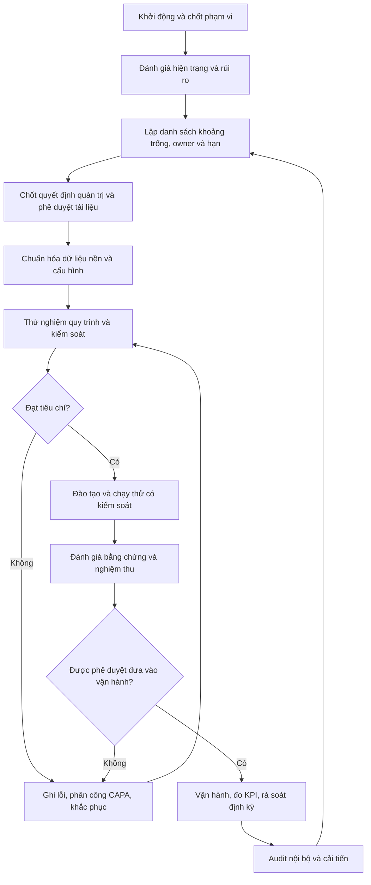

# HƯỚNG DẪN TRIỂN KHAI VÀ VẬN HÀNH HỆ THỐNG QUẢN LÝ DỊCH VỤ CNTT MSTAR

**Mã tài liệu:** MSTAR-ITSM-IMP-001  
**Phiên bản:** 1.0-DRAFT | **Chủ sở hữu:** Phòng CNTT | **Người phê duyệt:** Ban Giám đốc/người được ủy quyền  
**Ngày:** 24/10/2026 | **Trạng thái:** DỰ THẢO — chưa ban hành, chưa xác nhận triển khai thực tế.

> Tài liệu này hướng dẫn triển khai các tài liệu được liệt kê tại [ITSM Master Index](../../ITSM-MASTER-INDEX.md). Có tài liệu trong repository không tự chứng minh tài liệu đã được phê duyệt hoặc kiểm soát đã vận hành hiệu quả. Không đưa mật khẩu, token, khóa riêng hay thông tin bí mật vào Git, ticket hoặc biểu mẫu thông thường.

## 1. Mục đích

Chuyển quy chế, chính sách, quy trình, biểu mẫu và checklist ITSM/ATTT của MSTAR thành hoạt động vận hành có chủ sở hữu, cấu hình được kiểm soát, thử nghiệm, bằng chứng và nghiệm thu.

Tài liệu này hướng dẫn cách triển khai; không thay thế các quy trình nghiệp vụ chi tiết. Khi có khác biệt, không tự sửa số liệu SLA, RTO/RPO, ngưỡng giám sát hoặc thẩm quyền: ghi nhận thành vấn đề cần quyết định và xin phê duyệt.

## 2. Phạm vi và nguyên tắc

### 2.1 Phạm vi đề xuất
- Quản trị dịch vụ CNTT, danh mục dịch vụ và SLA.
- Ticket, sự cố, yêu cầu dịch vụ, thay đổi và sự kiện ATTT.
- Tài sản, tài khoản, phân quyền, File Server và phần mềm/bản quyền.
- Hạ tầng, sơ đồ mạng, giám sát Zabbix, backup/restore và BCP/DR.
- Nhà cung cấp, tài liệu/hồ sơ, đào tạo, KPI, đánh giá nội bộ và CAPA.

Phạm vi cuối cùng, đơn vị/site, dịch vụ bao gồm/loại trừ và các bên cung cấp phải được Ban Giám đốc phê duyệt trước khi coi đây là phạm vi quản lý chính thức.

### 2.2 Nguyên tắc kiểm soát
1. Không thay đổi production nếu chưa có ticket/change, đánh giá tác động, phê duyệt phù hợp, kế hoạch rollback và kiểm thử.
2. Quyền truy cập phải có yêu cầu hợp lệ, chủ dữ liệu/chủ dịch vụ phê duyệt khi cần, áp dụng quyền tối thiểu và có bằng chứng thu hồi.
3. Không sử dụng nguyên trạng các hướng dẫn cũ nếu chưa xác minh cấu hình hiện hành và rủi ro.
4. Mọi kiểm tra có kết quả Fail phải tạo hành động/ticket, owner, hạn và bằng chứng đóng.
5. Không đánh dấu “đã triển khai” chỉ dựa vào việc tạo file hoặc cấu hình sơ bộ.
6. Bằng chứng phải có ngày/giờ, người thực hiện, đối tượng kiểm tra, kết quả và vị trí lưu được kiểm soát; không chứa secret.
7. Ngoại lệ và rủi ro còn lại phải được ghi nhận và chấp nhận bởi đúng thẩm quyền.

## 3. Tài liệu liên quan

- [ITSM Master Index](../../ITSM-MASTER-INDEX.md) — danh mục tài liệu chuẩn.
- [Đánh giá 10 hồ sơ gốc và khoảng trống](00-DANH-GIA-10-HO-SO-GOC.md).
- [Danh mục quyết định và checklist ban hành](08-DANH-MUC-PHE-DUYET-TRUOC-BAN-HANH.md).
- [Bộ biểu mẫu vận hành](09-BO-BIEU-MAU-VAN-HANH.md).
- [Đối chiếu ISO/IEC 20000-1 và ISO/IEC 27001](11-DOI-CHIEU-ISO-20000-1-ISO-27001.md).
- Các quy trình liên quan theo Master Index: Incident, Request, SLA, Asset, IAM, File Server, Change, Monitoring, Backup/Restore, Security Incident, Vendor/License, Daily Operations, Joiner/Mover/Leaver và Document Control.
- Chính sách liên quan: phân loại thông tin/chia sẻ/lưu trữ; sử dụng CNTT/phần mềm/bản quyền; BCP/DR; đánh giá và xử lý rủi ro ATTT.

## 4. Vai trò và trách nhiệm

| Vai trò | Trách nhiệm chính |
|---|---|
| Ban Giám đốc/người được ủy quyền | Phê duyệt phạm vi, chính sách, SLA/ngoại lệ và chấp nhận rủi ro theo thẩm quyền; xem xét kết quả |
| IT Lead / ITSM Coordinator | Điều phối kế hoạch, chủ quy trình, theo dõi tiến độ/khoảng trống, báo cáo và chuẩn bị đánh giá |
| Service Owner / Data Owner / Risk Owner | Xác định yêu cầu dịch vụ, quyền dữ liệu, rủi ro, tiêu chí nghiệm thu và phê duyệt thuộc phạm vi |
| System/Network/Monitoring Owner | Thực hiện thay đổi kỹ thuật, lưu cấu hình/bằng chứng, kiểm thử và duy trì runbook |
| Service Desk / Help Desk | Tiếp nhận, phân loại, cập nhật ticket, thông báo, xác nhận kết quả và lưu bằng chứng |
| Asset/Procurement/Finance Owner | Đối soát tài sản, hợp đồng, phần mềm, license, chi phí và vòng đời |
| Người kiểm thử/đánh giá | Kiểm tra độc lập phù hợp với quy mô; ghi nhận kết quả, lỗi và xác minh CAPA |
| Người dùng/đơn vị nghiệp vụ | Gửi yêu cầu đúng kênh, cung cấp thông tin, thử nghiệm và xác nhận kết quả khi cần |

Tên cá nhân, người thay thế và phân quyền phê duyệt phải được MSTAR điền vào RACI/ma trận thẩm quyền riêng; bảng này không tự cấp quyền phê duyệt.

## 5. Luồng triển khai tổng thể

## 6. Giai đoạn 0 — Khởi động và kiểm tra rủi ro tức thời

### 6.1 Công việc
1. Chỉ định ITSM Coordinator và owner cho từng quy trình/chính sách.
2. Xác nhận repository/nhánh tài liệu là nơi quản lý dự thảo; xác định kho chính thức cho hồ sơ vận hành và tài liệu đã ban hành.
3. Kiểm tra các file bàn giao/danh mục cũ có chứa username/password hoặc secret. Hạn chế truy cập, không sao chép secret vào tài liệu mới; nếu có nguy cơ lộ, thực hiện quy trình đổi secret và lưu bằng chứng không chứa giá trị secret.
4. Xác minh trạng thái backup job gần nhất, cảnh báo backup thất bại, quyền quản trị backup và khả năng truy cập bản sao.
5. Xác minh File Server ACL hiện tại, đặc biệt quyền ghi/xóa tại thư mục dùng chung. Không thay đổi quyền hàng loạt khi chưa có owner, đánh giá tác động, phê duyệt và rollback.
6. Xác minh cảnh báo Zabbix cho hệ thống trọng yếu có đến đúng người nhận không.
7. Tạo ticket/risk record cho phát hiện, ghi mức độ, owner, hạn và hành động tạm thời.

### 6.2 Bằng chứng
- Biên bản kiểm tra và ticket liên quan.
- Báo cáo trạng thái backup; kết quả kiểm tra alert.
- ACL export được lưu tại kho hạn chế quyền (không đưa dữ liệu nhạy cảm vào Git).
- Biên bản xử lý secret nếu có.
- Danh sách rủi ro cần xử lý ngay và người chịu trách nhiệm.

### 6.3 Tiêu chí hoàn thành
Mỗi phát hiện có kết luận, owner, hạn, mức độ, hành động và người rà soát. Rủi ro nghiêm trọng chưa xử lý phải có biện pháp giảm thiểu tạm thời và quyết định của đúng thẩm quyền.

## 7. Giai đoạn 1 — Chốt quản trị trước cấu hình

### 7.1 Các quyết định cần hoàn thành
- Phạm vi SMS/ISMS, dịch vụ/site bao gồm và loại trừ.
- Service Catalogue, Service Owner, Data Owner, nhà cung cấp và phụ thuộc.
- RACI, thẩm quyền phê duyệt, người thay thế và escalation.
- SLA, lịch làm việc, múi giờ, ngày nghỉ, quy tắc pause/resume và định nghĩa các mốc thời gian.
- Ma trận ưu tiên P1–P4 và tiêu chí Major Incident.
- Phân loại thông tin, nơi lưu/chia sẻ được phép, retention và hủy.
- Danh mục phần mềm được phép, thẩm quyền cài đặt và ngoại lệ.
- Phương pháp đánh giá rủi ro, thang điểm, tiêu chí chấp nhận và phê duyệt rủi ro còn lại.
- BIA, RTO/RPO và mục tiêu kiểm thử theo từng dịch vụ trọng yếu.
- Ngưỡng giám sát, người nhận cảnh báo và cơ chế trực/đáp ứng.

### 7.2 Quy tắc không tự suy diễn
Hồ sơ Helpdesk/SLA nguồn còn thiếu giá trị Response Time của M-Service. Không tự điền. Các đơn vị phải xác nhận bằng văn bản. Đối với SLA tính theo ngày, cần quyết định rõ ngày lịch hay ngày làm việc. Mọi giá trị RTO/RPO, retention, ngưỡng giám sát và escalation chưa được phê duyệt phải để trạng thái “CHỜ QUYẾT ĐỊNH”.

### 7.3 Bằng chứng
Biên bản quyết định, chính sách/SLA có phê duyệt, Service Catalogue, RACI và Document Register.

## 8. Giai đoạn 2 — Chuẩn hóa dữ liệu nền

### 8.1 Tài sản và cấu hình
1. Xuất dữ liệu tài sản từ hệ thống hiện hữu và thu thập danh sách thiết bị thực tế.
2. Đối soát mã tài sản, loại, serial, hostname, vị trí/site, owner, trạng thái, bảo hành và nhà cung cấp.
3. So sánh taxonomy trong hồ sơ quy hoạch tài sản với dữ liệu TAISAN.MSTARCORP.VN; lập mapping cho giá trị trùng/khác và xin phê duyệt.
4. Kiểm kê vật lý theo kế hoạch được duyệt; ghi nhận chênh lệch và hành động.
5. Lập sơ đồ mạng as-built cho từng site, bao gồm ISP/WAN, firewall, switch, subnet/VLAN, Wi-Fi, server, NAS và các phụ thuộc đã xác minh.
6. Chỉ ghi cấu hình mạng đã kiểm tra; không suy ra sơ đồ hiện trạng từ template sơ đồ.

### 8.2 Danh mục dịch vụ, phần mềm và nhà cung cấp
- Lập Service Catalogue với mô tả, giờ hỗ trợ, owner, khách hàng/đơn vị sử dụng, phụ thuộc và SLA đã duyệt.
- Lập software inventory bằng nguồn dữ liệu được phê duyệt; phân biệt phần mềm được phép, cần kiểm tra và không được phép.
- Đối soát license, số lượng, điều khoản, ngày hết hạn và owner.
- Lập vendor/contract/domain/SSL register có người phụ trách, ngày gia hạn và phương thức cảnh báo.
- Không lưu mật khẩu/API token trong các register; chỉ lưu tham chiếu đến kho bí mật được phê duyệt.

### 8.3 Bằng chứng
Bản export nguồn, quy tắc mapping, báo cáo đối soát, danh sách sai lệch, biên bản kiểm kê, sơ đồ có version/owner và các register đã được owner rà soát.

## 9. Giai đoạn 3 — Cấu hình và kiểm thử từng quy trình

### 9.1 Ticket, Incident và Service Request
1. Xác định các loại ticket và mẫu thông tin bắt buộc.
2. Thiết lập requester, service, site, impact, urgency/priority, owner, trạng thái, thời gian và liên kết tài sản/CI khi phù hợp.
3. Cấu hình quyền xem/sửa và luồng phê duyệt theo loại yêu cầu.
4. Cấu hình SLA chỉ sau khi các giá trị và lịch đã được duyệt.
5. Kiểm thử ticket thiếu thông tin, ticket khẩn cấp, chuyển nhóm, quá SLA, escalation, giải quyết, mở lại và đóng.
6. Đảm bảo yêu cầu qua điện thoại/Zalo/kênh khác được ghi lại ticket theo quy định.
7. Xác nhận người dùng được thông báo và bằng chứng đóng ticket được lưu.

### 9.2 SLA và escalation
- Lập ma trận theo dịch vụ, priority, thời gian phản hồi/giải quyết, lịch áp dụng, ngưỡng cảnh báo và người nhận.
- Kiểm tra các giá trị với hồ sơ nguồn và phê duyệt; không tự sửa số liệu nguồn còn thiếu.
- Dùng ticket thử nghiệm để xác nhận thời điểm bắt đầu, pause/resume nếu áp dụng, thời điểm quá hạn và escalation.
- So sánh báo cáo SLA của hệ thống với phép tính mẫu độc lập.
- Lưu cấu hình đã duyệt, kết quả kiểm thử, sai lệch và phê duyệt nghiệm thu.

### 9.3 Tài sản, bàn giao và vòng đời
- Chuẩn hóa mã và trường dữ liệu bắt buộc.
- Thử quy trình tiếp nhận, cấp phát, mượn/trả, chuyển người dùng/vị trí, sửa chữa, bảo hành, mất/hỏng và thanh lý.
- Đối chiếu ticket/biên bản với lịch sử tài sản.
- Kiểm tra mẫu bàn giao không chứa mật khẩu.
- Thực hiện kiểm kê mẫu và ghi nhận sai lệch.

### 9.4 Tài khoản, Joiner/Mover/Leaver và quyền
- Yêu cầu cấp/sửa/thu hồi tài khoản phải có requester, người được cấp, lý do, hệ thống/role, thời hạn và approval phù hợp.
- Xác minh danh tính và thẩm quyền trước thao tác.
- Áp dụng quyền tối thiểu; tách tài khoản quản trị khi phù hợp; bảo vệ thông tin xác thực.
- Kiểm thử cấp quyền, từ chối quyền không được duyệt, đổi vai trò và thu hồi khi nghỉ việc.
- Rà soát tài khoản đặc quyền và tài khoản không còn owner theo lịch được duyệt.
- Lưu ticket/approval, kết quả kiểm thử và bằng chứng thu hồi; không lưu secret.

### 9.5 File Server và dữ liệu
- Xác định Data Owner và nhóm quyền cho từng thư mục.
- Xuất ACL hiện trạng và đối chiếu với ma trận quyền đã duyệt.
- Thử truy cập được phép và bị từ chối bằng tài khoản kiểm thử phù hợp.
- Đánh giá quyền ghi/xóa tại PUBLIC và quyền truy cập dữ liệu nhạy cảm.
- Thực hiện thay đổi bằng change được duyệt, có backup/rollback và kiểm thử sau thay đổi.
- Rà soát định kỳ quyền, chia sẻ ngoài và việc lưu dữ liệu ở kho được phép.

### 9.6 Change Management
- Ghi mục đích, phạm vi, hệ thống bị ảnh hưởng, rủi ro, kế hoạch triển khai, kiểm thử, thời gian, phê duyệt và rollback.
- Phân biệt thay đổi thường lệ, thông thường và khẩn cấp theo tiêu chí được phê duyệt.
- Không coi việc ghi ticket sau khi làm là thay thế cho phê duyệt trước, trừ quy trình khẩn cấp được định nghĩa rõ.
- Sau thay đổi, kiểm tra dịch vụ, cập nhật CMDB/sơ đồ/runbook và đóng change kèm bằng chứng.

### 9.7 Zabbix Monitoring
- Lập monitoring matrix: host/CI, dịch vụ, template/agent/SNMP, chỉ số, ngưỡng, severity, người nhận, runbook và liên kết ticket.
- Xác minh credential được bảo vệ và quyền truy cập quản trị.
- Kiểm thử cảnh báo bằng phương pháp an toàn, được duyệt; xác nhận người nhận và acknowledgement.
- Kiểm thử tình huống host unreachable, dung lượng, dịch vụ dừng và backup thất bại nếu thuộc phạm vi giám sát.
- Theo dõi false positive, cảnh báo lặp, cảnh báo không có owner và điều chỉnh qua change.
- Không ghi ngưỡng giả định vào chính sách; ngưỡng phải được owner duyệt.

### 9.8 Backup/Restore và BCP/DR
- Lập backup inventory theo dịch vụ/dữ liệu, owner, lịch, retention, vị trí, quyền, trạng thái job và phương thức bảo vệ bản sao.
- Xác minh log thành công/thất bại và quy trình xử lý job thất bại.
- Xác định RTO/RPO bằng BIA và phê duyệt theo dịch vụ; không dùng giá trị minh họa làm cam kết.
- Xây dựng runbook phục hồi có điều kiện khởi động, người chỉ huy, thứ tự khôi phục, phụ thuộc, xác nhận nghiệp vụ và phương án quay lại.
- Thử khôi phục ở môi trường/điều kiện được phê duyệt; ghi thời điểm bắt đầu/kết thúc, dữ liệu khôi phục, lỗi và kết quả so với mục tiêu.
- Lập lịch tabletop/DR test; ghi người tham gia, quyết định, vấn đề và CAPA.
- Sau thử nghiệm, bảo đảm môi trường thử được dọn dẹp và dữ liệu nhạy cảm được xử lý an toàn.

### 9.9 Security Incident, vendor và license
- Thiết lập kênh báo cáo, mức độ sự cố, người chỉ huy, escalation và quy tắc bảo toàn bằng chứng.
- Thử diễn tập bàn giấy cho sự cố nghiêm trọng và ghi lại quyết định/liên lạc.
- Đối soát vendor/license/domain/SSL, thời hạn, hợp đồng và owner; thử cảnh báo gia hạn.
- Rà soát quyền truy cập của nhà cung cấp, thời hạn, phê duyệt và thu hồi khi kết thúc hợp đồng.
- RCA/CAPA phải có nguyên nhân, hành động, owner, hạn và xác minh hiệu lực.

### 9.10 Daily Operations
- Chuẩn hóa checklist thành từng mục có kết quả mong đợi, thời điểm, người thực hiện, evidence và người rà soát.
- Mỗi mục phải có Pass/Fail/N/A và lý do cho N/A.
- Fail phải tạo ticket/action có owner/hạn và link tham chiếu.
- Chạy thử checklist qua các kỳ liên tiếp theo chu kỳ được duyệt; tổng hợp lỗi lặp và hành động.

## 10. Giai đoạn 4 — Đào tạo và chạy thử

### 10.1 Đào tạo theo vai trò
- Service Desk: tiếp nhận, phân loại, SLA, giao tiếp, escalation và đóng ticket.
- System/Network: change, quyền truy cập, backup/restore, monitoring và bằng chứng.
- Owner/quản lý: phê duyệt yêu cầu, chấp nhận rủi ro, SLA và nghiệm thu.
- Người dùng: kênh yêu cầu, bảo vệ dữ liệu, sử dụng phần mềm và báo cáo sự cố.

Mỗi buổi đào tạo cần có tài liệu, đối tượng, ngày, người hướng dẫn, danh sách tham gia và cách xác nhận hiểu biết. Lưu hồ sơ tại kho được kiểm soát.

### 10.2 Bộ kịch bản chạy thử tối thiểu
1. Ticket thông thường được tiếp nhận, giao đúng owner và đóng đúng cách.
2. Ticket thiếu thông tin được yêu cầu bổ sung.
3. Ticket sắp/quá SLA kích hoạt đúng cảnh báo/escalation.
4. Yêu cầu cấp quyền có phê duyệt; yêu cầu không hợp lệ bị từ chối.
5. Người dùng chuyển bộ phận và nghỉ việc được xử lý đúng quyền.
6. Change bị từ chối khi thiếu approval hoặc rollback.
7. Zabbix cảnh báo tới đúng người và được xử lý qua quy trình.
8. Backup lỗi được phát hiện, tạo hành động và theo dõi đến khi khắc phục.
9. Restore test được ghi nhận và so với RTO/RPO đã duyệt.
10. Security Incident được báo cáo, phân loại, escalation và lưu bằng chứng.
11. Tài sản được cấp phát/thu hồi và register được cập nhật.
12. Daily checklist có Fail tạo ticket/action và được rà soát.

### 10.3 Điều kiện đạt
Kịch bản có tiêu chí expected result trước khi chạy; kết quả actual, bằng chứng, người kiểm thử và ngày chạy được lưu. Lỗi trọng yếu phải được khắc phục và kiểm thử lại hoặc được chấp nhận ngoại lệ bằng văn bản đúng thẩm quyền.

## 11. Giai đoạn 5 — Nghiệm thu và vận hành chính thức

Chỉ đề nghị ban hành/vận hành chính thức khi:
- Phạm vi và owner đã được duyệt.
- Chính sách/quy trình/biểu mẫu cần thiết có version, approver, ngày hiệu lực và nơi lưu chính thức.
- Các giá trị quản trị còn thiếu đã được quyết định.
- Kiểm soát trọng yếu được cấu hình/áp dụng và có bằng chứng kiểm thử.
- Nhân sự liên quan được hướng dẫn.
- Có kế hoạch hỗ trợ, escalation, lưu bằng chứng và xử lý lỗi.
- Các điểm không phù hợp còn lại có owner/hạn và được xử lý theo thẩm quyền; rủi ro còn lại được chấp nhận hợp lệ.
- Người có thẩm quyền ký nghiệm thu và công bố hiệu lực.

Không tuyên bố chứng nhận ISO hoặc tuân thủ toàn diện chỉ vì hoàn tất tài liệu hay checklist.

## 12. Theo dõi hiệu lực, KPI và cải tiến

Chỉ tiêu phải được định nghĩa, phê duyệt, xác định nguồn dữ liệu và baseline trước khi báo cáo như KPI chính thức. Các chỉ số gợi ý:
- Tỷ lệ ticket đáp ứng SLA theo dịch vụ/priority.
- Tuổi backlog và số ticket quá hạn.
- Tỷ lệ ticket có đủ trường bắt buộc và bằng chứng đóng.
- Tỷ lệ tài sản đối soát được với thực tế.
- Tỷ lệ rà soát/thu hồi quyền đúng hạn.
- Tỷ lệ backup thành công; tỷ lệ restore test đạt mục tiêu.
- Tỷ lệ cảnh báo được acknowledgement trong thời gian quy định.
- Tỷ lệ change thành công, rollback và change khẩn cấp.
- Tỷ lệ CAPA hoàn thành đúng hạn và hiệu lực được xác minh.
- Tỷ lệ đào tạo hoàn thành.

Mỗi KPI phải có công thức, nguồn, owner, chu kỳ, mục tiêu đã duyệt, quy tắc loại trừ và cách kiểm tra chất lượng dữ liệu. Không tự đặt target khi chưa được phê duyệt.

## 13. Kiểm soát hồ sơ và bằng chứng

Mỗi hồ sơ triển khai cần tối thiểu:
- ID công việc/ticket/change/test.
- Quy trình/chính sách liên quan và phiên bản.
- Hệ thống/CI/service được kiểm tra.
- Ngày giờ, người thực hiện và người rà soát.
- Kết quả mong đợi và kết quả thực tế.
- Bằng chứng hoặc tham chiếu tới kho được kiểm soát.
- Phát hiện, mức độ, owner, hạn và CAPA.
- Quyết định nghiệm thu/ngoại lệ.

Thời hạn lưu, nơi lưu, quyền truy cập và phương thức hủy phải theo chính sách lưu giữ hồ sơ đã được phê duyệt. Không commit log nhạy cảm, export ACL có dữ liệu cá nhân, cấu hình bí mật hoặc credential vào repository.

## 14. Mẫu kế hoạch triển khai

| ID | Hạng mục | Tài liệu liên quan | Hiện trạng | Việc cần làm | Owner | Approver | Hạn | Bằng chứng | Kiểm thử | Trạng thái | CAPA/Risk |
|---|---|---|---|---|---|---|---|---|---|---|---|
| IMP-001 | Chốt phạm vi SMS/ISMS | Master Index | Chưa xác minh | Lập phạm vi và xin phê duyệt | Chưa phân công | Chưa chốt | Chưa chốt | Scope statement | Rà soát phạm vi | Chưa bắt đầu | — |
| IMP-002 | Chốt SLA M-Service | SLA baseline | Thiếu giá trị phản hồi trong nguồn | Lấy quyết định bằng văn bản | Service Owner | BGĐ/ủy quyền | Chưa chốt | SLA phê duyệt | Test ticket/SLA | Chờ quyết định | — |
| IMP-003 | Kiểm tra File Server ACL | File Server procedure | Chưa xác minh hiện trạng | Export ACL, review Data Owner, test | System/Data Owner | IT Lead/đúng thẩm quyền | Chưa chốt | ACL review + change/test | Allowed/denied test | Chưa bắt đầu | — |
| IMP-004 | Kiểm tra backup/restore | Backup/BCDR | Chưa xác minh | Kiểm tra job, retention và restore test | System Owner | Service Owner | Chưa chốt | Report và test record | So sánh RTO/RPO duyệt | Chưa bắt đầu | — |
| IMP-005 | Zabbix alert test | Monitoring | Chưa xác minh | Lập matrix và test cảnh báo | Monitoring Owner | IT Lead | Chưa chốt | Test alert record | Xác nhận người nhận/ticket | Chưa bắt đầu | — |
| IMP-006 | Đối soát tài sản | Asset Management | Chưa xác minh | Export, kiểm kê và reconcile | Asset Owner | IT Lead/Finance khi cần | Chưa chốt | Inventory report | Kiểm tra mẫu | Chưa bắt đầu | — |
| IMP-007 | Risk Register | Risk policy | Chưa xác minh | Đánh giá rủi ro và treatment | Risk Owner | BGĐ theo thẩm quyền | Chưa chốt | Risk Register | Review residual risk | Chưa bắt đầu | — |
| IMP-008 | BIA/BCP/DR | BCP/DR policy | Chưa xác minh | BIA, RTO/RPO, runbook và exercise | Service Owner | BGĐ | Chưa chốt | BIA/DR test report | Exercise/restore test | Chưa bắt đầu | — |

Bảng trên là mẫu khởi động; cần mở rộng thành toàn bộ danh sách khoảng trống trong báo cáo đánh giá. Owner, hạn và trạng thái thực tế phải được MSTAR cập nhật; không coi các giá trị “chưa xác minh” là kết quả kiểm tra tại hiện trường.

## 15. Tiêu chí đóng hạng mục triển khai

Chỉ chuyển hạng mục sang “Đã nghiệm thu” khi có:
1. Tài liệu/quyết định được phê duyệt nếu cần.
2. Owner được giao.
3. Cấu hình/thao tác áp dụng trên môi trường thực tế.
4. Kết quả kiểm thử và bằng chứng có thể truy xuất.
5. Người có trách nhiệm rà soát kết quả.
6. Lỗi được đóng, hoặc rủi ro còn lại được chấp nhận đúng thẩm quyền.
7. Hồ sơ được lưu tại nơi kiểm soát và tham chiếu từ register/ticket.

**Các trạng thái chuẩn:** Chưa bắt đầu → Đang thực hiện → Chờ kiểm thử → Chờ phê duyệt → Đã nghiệm thu → Theo dõi hiệu lực. Nếu kiểm thử không đạt, mở CAPA và quay lại bước khắc phục.

## 16. Lịch rà soát tài liệu

Rà soát theo lịch được MSTAR phê duyệt và khi có thay đổi lớn về hệ thống, dịch vụ, rủi ro, nhà cung cấp, quy định hoặc sau sự cố/diễn tập. Mọi sửa đổi phải có lịch sử phiên bản, người rà soát, người phê duyệt và ngày hiệu lực; tài liệu cũ phải được đánh dấu/thu hồi theo quy trình Document Control.

## 17. Phê duyệt

- Người soạn: ____________________ Ngày: __________
- Người rà soát kỹ thuật: ____________________ Ngày: __________
- Service Owner/đơn vị liên quan: ____________________ Ngày: __________
- Người phê duyệt: ____________________ Ngày hiệu lực: __________
- Ngoại lệ được chấp nhận và thời hạn: __________________________________
- Vị trí lưu hồ sơ nghiệm thu: ___________________________________________

---
**Lưu ý:** Đây là hướng dẫn triển khai dự thảo, không phải tuyên bố chứng nhận ISO. MSTAR cần xác minh hiện trạng, phê duyệt các thông số còn thiếu, triển khai và lưu bằng chứng trước khi kết luận kiểm soát đã vận hành hiệu quả.
