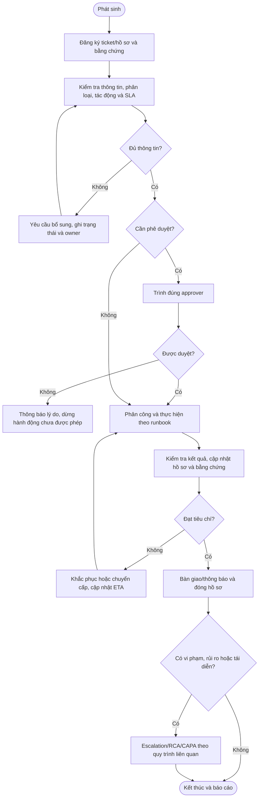

# ITSM-INC-001 — Quản lý sự cố

**Trạng thái:** DRAFT v1.0 | Owner: IT Lead | Approver: [CẦN CHỐT]

## Mục tiêu
Khôi phục dịch vụ nhanh, giảm tác động, ghi timeline và ngăn tái diễn.

## Quy trình
1. Nhận từ Bitrix, điện thoại, Zalo hoặc Zabbix; nếu chưa có ticket thì tạo ngay.
2. Ghi requester, site/khách hàng, dịch vụ/tài sản, triệu chứng, thời điểm, tác động, phạm vi và bằng chứng.
3. Chọn ưu tiên theo ma trận P1–P4 [CẦN CHỐT]; không tự suy đoán khi thiếu dữ liệu.
4. Xác nhận tiếp nhận trong Response Time của SLA đã duyệt.
5. Giao owner/nhóm; cập nhật chẩn đoán, workaround và bước tiếp theo.
6. Với sự cố diện rộng/nghiêm trọng, kích hoạt Major Incident, chỉ định điều phối và kênh cập nhật [CẦN CHỐT].
7. Khắc phục trong thẩm quyền; thay đổi production phải tuân thủ Change Management.
8. Xác minh phục hồi với requester/monitoring; ghi thời gian, tác động còn lại.
9. Đóng ticket theo quy tắc đóng đã duyệt, có xác nhận hoặc ghi lý do.
10. Sự cố nghiêm trọng/tái diễn phải có RCA/Problem, owner, deadline và biện pháp phòng ngừa.

## Trường bắt buộc
Ticket ID, requester, đơn vị/site, service/CI, mô tả, tác động, priority, assignee, timestamps, cập nhật, kết quả và evidence.

## Kiểm soát
Không xóa bằng chứng hoặc ghi mật khẩu vào ticket. Ticket phải có owner. Sự cố an ninh liên kết `10-SECURITY-INCIDENT.md`. SLA xem `../../SLA-BASELINE.md`; giá trị chưa rõ cần xác nhận.

## Kiểm soát vận hành chung
- **Trạng thái:** DỰ THẢO — chỉ có hiệu lực sau phê duyệt theo thẩm quyền MSTAR.
- **Phân biệt nội dung:** thông tin được trích từ hồ sơ nguồn là căn cứ hiện có; kiểm soát bổ sung là đề xuất; các giá trị thiếu phải được chốt trước ban hành.
- **Vai trò:** requester/đơn vị yêu cầu cung cấp thông tin; Service Desk/IT tiếp nhận và điều phối; process owner chịu trách nhiệm chất lượng; approver quyết định theo ma trận thẩm quyền; IT Lead giám sát ngoại lệ và báo cáo.
- **Bằng chứng:** ticket/hồ sơ phải truy xuất được người yêu cầu, người xử lý, thời điểm, phê duyệt, kết quả và liên kết bằng chứng. Không lưu mật khẩu, token, private key hoặc recovery code trong ticket, CSV, email thông thường hay Git.
- **Chuyển quy trình:** gián đoạn dịch vụ liên kết ITSM-INC-001; dấu hiệu ATTT liên kết ITSM-SEC-001; thay đổi production liên kết ITSM-CHG-001; cấp quyền liên kết ITSM-IAM-001; restore liên kết ITSM-BKP-001.

## Lưu đồ

## Luồng công việc đặc thù — ITSM-INC-001 Quản lý sự cố
1. **Kích hoạt:** Phát hiện gián đoạn/suy giảm dịch vụ.
2. **Tiếp nhận/đánh giá:** Ghi ticket, thời điểm, phạm vi, tác động và bằng chứng.
3. **Kiểm soát:** Phân loại theo ma trận ưu tiên đã duyệt; chỉ định incident owner.
4. **Thực hiện:** Chẩn đoán, workaround, cập nhật tiến độ; thay đổi production theo CHG.
5. **Xác minh và kết thúc:** Khôi phục, kiểm tra dịch vụ với owner/requester, ghi timeline.
6. **Điều kiện chuyển cấp/ngoại lệ:** Đóng ticket hoặc chuyển RCA/CAPA nếu nghiêm trọng/tái diễn.
7. **Bằng chứng đặc thù:** Sự cố diện rộng, dữ liệu/ATTT có nguy cơ, quá SLA.
8. **KPI đề xuất:** Ticket, timeline, logs, thông báo, RCA khi cần.

## Hồ sơ, chỉ số và checklist đóng
- **Hồ sơ tối thiểu:** ticket/mã tham chiếu, đầu vào, phân loại, SLA nếu áp dụng, phê duyệt nếu cần, người thực hiện, timeline, kết quả kiểm tra, thông báo/bàn giao và bằng chứng.
- **Nơi lưu/thời hạn:** theo kho lưu và chính sách lưu hồ sơ được MSTAR phê duyệt; không tự đặt thời hạn.
- **Chỉ số:** dùng các KPI đề xuất bên dưới như chỉ số tham khảo; process owner phải xác nhận định nghĩa, nguồn dữ liệu, chu kỳ và mục tiêu trước khi áp dụng chính thức.
- **Checklist đóng:** [ ] đúng requester/owner; [ ] phê duyệt đầy đủ; [ ] kết quả đã kiểm tra; [ ] ticket/register cập nhật; [ ] không chứa secret; [ ] bằng chứng truy xuất được; [ ] vi phạm/tái diễn đã escalation/RCA/CAPA.
- **Điểm cần chốt trước ban hành:** owner/approver và người thay thế; ma trận ưu tiên/escalation; lịch và quy tắc SLA liên quan; ngưỡng kỹ thuật hoặc retention nếu áp dụng; kho hồ sơ/quyền/thời hạn lưu; kiểm thử quy trình và ghi nhận kết quả.
