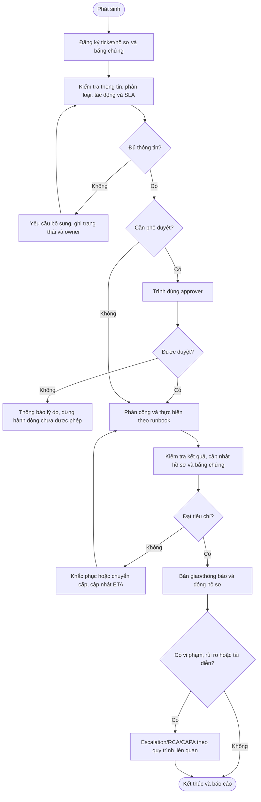

# ITSM-REQ-001 — Quản lý yêu cầu dịch vụ

**Trạng thái:** DRAFT v1.0 | Owner: Service Desk | Approver: [CẦN CHỐT]

## Phạm vi
Cấp thiết bị, phần mềm, email/tài khoản, VPN, quyền File Server, hỗ trợ người dùng, mượn/trả và yêu cầu nội bộ.

## Quy trình
1. Người dùng tạo ticket Bitrix, chọn template. Yêu cầu qua điện thoại/Zalo cần được ghi vào ticket.
2. Ghi mục đích, requester, người nhận, bộ phận/site, ngày cần, dịch vụ/tài sản và thông tin hỗ trợ.
3. Service Desk kiểm tra thông tin, request type, SLA và approvals cần thiết.
4. Kiểm tra quyền, tồn kho, license, ngân sách và chính sách; yêu cầu bổ sung nếu thiếu.
5. Lấy phê duyệt manager/service owner/data owner trước khi cấp quyền, phát sinh chi phí, truy cập dữ liệu nhạy cảm hoặc thay đổi production.
6. IT thực hiện theo runbook đã duyệt; cập nhật tài sản/tài khoản/cấu hình.
7. Kiểm thử kết quả cùng người dùng; cập nhật register và tài liệu liên quan.
8. Đóng ticket khi hoàn tất và có xác nhận hoặc theo quy tắc đã duyệt.

## Kiểm soát
Không cài phần mềm trái license/chính sách; không cấp quyền từ yêu cầu không xác thực; phê duyệt phải truy vết được.

## Kiểm soát vận hành chung
- **Trạng thái:** DỰ THẢO — chỉ có hiệu lực sau phê duyệt theo thẩm quyền MSTAR.
- **Phân biệt nội dung:** thông tin được trích từ hồ sơ nguồn là căn cứ hiện có; kiểm soát bổ sung là đề xuất; các giá trị thiếu phải được chốt trước ban hành.
- **Vai trò:** requester/đơn vị yêu cầu cung cấp thông tin; Service Desk/IT tiếp nhận và điều phối; process owner chịu trách nhiệm chất lượng; approver quyết định theo ma trận thẩm quyền; IT Lead giám sát ngoại lệ và báo cáo.
- **Bằng chứng:** ticket/hồ sơ phải truy xuất được người yêu cầu, người xử lý, thời điểm, phê duyệt, kết quả và liên kết bằng chứng. Không lưu mật khẩu, token, private key hoặc recovery code trong ticket, CSV, email thông thường hay Git.
- **Chuyển quy trình:** gián đoạn dịch vụ liên kết ITSM-INC-001; dấu hiệu ATTT liên kết ITSM-SEC-001; thay đổi production liên kết ITSM-CHG-001; cấp quyền liên kết ITSM-IAM-001; restore liên kết ITSM-BKP-001.

## Lưu đồ

## Luồng công việc đặc thù — ITSM-REQ-001 Yêu cầu dịch vụ
1. **Kích hoạt:** Người dùng hoặc bộ phận tạo yêu cầu.
2. **Tiếp nhận/đánh giá:** Xác minh danh tính, mục đích, người nhận, dịch vụ/tài sản và ngày cần.
3. **Kiểm soát:** Phân loại yêu cầu; kiểm tra chính sách, tồn kho, license, chi phí.
4. **Thực hiện:** Xin phê duyệt manager/service owner/data owner theo loại yêu cầu.
5. **Xác minh và kết thúc:** Thực hiện theo runbook; cập nhật tài sản/tài khoản/cấu hình nếu liên quan.
6. **Điều kiện chuyển cấp/ngoại lệ:** Kiểm tra, bàn giao, xác nhận và đóng ticket.
7. **Bằng chứng đặc thù:** Thiếu thông tin, bị từ chối, hết hàng/license, vượt thẩm quyền.
8. **KPI đề xuất:** Ticket, approval, biên bản bàn giao, evidence.

## Hồ sơ, chỉ số và checklist đóng
- **Hồ sơ tối thiểu:** ticket/mã tham chiếu, đầu vào, phân loại, SLA nếu áp dụng, phê duyệt nếu cần, người thực hiện, timeline, kết quả kiểm tra, thông báo/bàn giao và bằng chứng.
- **Nơi lưu/thời hạn:** theo kho lưu và chính sách lưu hồ sơ được MSTAR phê duyệt; không tự đặt thời hạn.
- **Chỉ số:** dùng các KPI đề xuất bên dưới như chỉ số tham khảo; process owner phải xác nhận định nghĩa, nguồn dữ liệu, chu kỳ và mục tiêu trước khi áp dụng chính thức.
- **Checklist đóng:** [ ] đúng requester/owner; [ ] phê duyệt đầy đủ; [ ] kết quả đã kiểm tra; [ ] ticket/register cập nhật; [ ] không chứa secret; [ ] bằng chứng truy xuất được; [ ] vi phạm/tái diễn đã escalation/RCA/CAPA.
- **Điểm cần chốt trước ban hành:** owner/approver và người thay thế; ma trận ưu tiên/escalation; lịch và quy tắc SLA liên quan; ngưỡng kỹ thuật hoặc retention nếu áp dụng; kho hồ sơ/quyền/thời hạn lưu; kiểm thử quy trình và ghi nhận kết quả.
