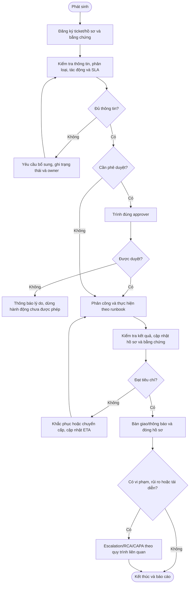

# ITSM-SLA-001 — SLA, ưu tiên và leo thang

**Trạng thái:** DRAFT v1.0 | Owner: IT Lead | Approver: [CẦN CHỐT]

## Nguyên tắc
Phân biệt Response Time và Resolve Time. Bảng SLA đã duyệt là nguồn chuẩn duy nhất của Bitrix và báo cáo. Ticket cần template/service, timestamp nhận/phản hồi/hoàn tất, trạng thái chờ và lý do.

## Quy trình
1. Gán SLA theo template/service đã duyệt.
2. Chốt lịch làm việc, ngày nghỉ, timezone, ngoài giờ và pause/resume SLA [CẦN CHỐT].
3. Cấu hình cảnh báo trước hạn/quá hạn theo phê duyệt.
4. Ticket có nguy cơ trễ phải có lý do, hành động, owner, ETA và thông báo.
5. Ticket quá hạn phải escalate theo ma trận, ghi timestamp/người nhận.
6. Báo cáo tuần/tháng gồm compliance, overdue, backlog, nguyên nhân và khắc phục.
7. Thay đổi cấu hình SLA cần phê duyệt và thông báo.

## Ưu tiên
Ma trận P1–P4 theo tác động × khẩn cấp cần Service Owner/BGĐ phê duyệt trước khi cấu hình.

## Cần chốt
Xem `../../SLA-BASELINE.md`: Response Time M-Service thiếu, một số escalation cần đối chiếu bảng nguồn.

## Kiểm soát vận hành chung
- **Trạng thái:** DỰ THẢO — chỉ có hiệu lực sau phê duyệt theo thẩm quyền MSTAR.
- **Phân biệt nội dung:** thông tin được trích từ hồ sơ nguồn là căn cứ hiện có; kiểm soát bổ sung là đề xuất; các giá trị thiếu phải được chốt trước ban hành.
- **Vai trò:** requester/đơn vị yêu cầu cung cấp thông tin; Service Desk/IT tiếp nhận và điều phối; process owner chịu trách nhiệm chất lượng; approver quyết định theo ma trận thẩm quyền; IT Lead giám sát ngoại lệ và báo cáo.
- **Bằng chứng:** ticket/hồ sơ phải truy xuất được người yêu cầu, người xử lý, thời điểm, phê duyệt, kết quả và liên kết bằng chứng. Không lưu mật khẩu, token, private key hoặc recovery code trong ticket, CSV, email thông thường hay Git.
- **Chuyển quy trình:** gián đoạn dịch vụ liên kết ITSM-INC-001; dấu hiệu ATTT liên kết ITSM-SEC-001; thay đổi production liên kết ITSM-CHG-001; cấp quyền liên kết ITSM-IAM-001; restore liên kết ITSM-BKP-001.

## Lưu đồ

## Luồng công việc đặc thù — ITSM-SLA-001 SLA và leo thang
1. **Kích hoạt:** Ticket được tạo và gán dịch vụ/template.
2. **Tiếp nhận/đánh giá:** Áp SLA baseline đã duyệt, ghi mốc nhận/phản hồi/hoàn tất.
3. **Kiểm soát:** Theo dõi response/resolve, trạng thái chờ và lý do theo chính sách.
4. **Thực hiện:** Cảnh báo trước hạn; giao owner, ETA và kế hoạch xử lý.
5. **Xác minh và kết thúc:** Quá hạn thì chuyển cấp theo ma trận đã duyệt, ghi người nhận/thời điểm.
6. **Điều kiện chuyển cấp/ngoại lệ:** Đối chiếu dữ liệu và lập báo cáo tuần/tháng.
7. **Bằng chứng đặc thù:** SLA thiếu giá trị, timestamp tranh chấp, lịch/ngày nghỉ chưa rõ.
8. **KPI đề xuất:** Ticket timestamps, trạng thái, escalation, báo cáo.

## Hồ sơ, chỉ số và checklist đóng
- **Hồ sơ tối thiểu:** ticket/mã tham chiếu, đầu vào, phân loại, SLA nếu áp dụng, phê duyệt nếu cần, người thực hiện, timeline, kết quả kiểm tra, thông báo/bàn giao và bằng chứng.
- **Nơi lưu/thời hạn:** theo kho lưu và chính sách lưu hồ sơ được MSTAR phê duyệt; không tự đặt thời hạn.
- **Chỉ số:** dùng các KPI đề xuất bên dưới như chỉ số tham khảo; process owner phải xác nhận định nghĩa, nguồn dữ liệu, chu kỳ và mục tiêu trước khi áp dụng chính thức.
- **Checklist đóng:** [ ] đúng requester/owner; [ ] phê duyệt đầy đủ; [ ] kết quả đã kiểm tra; [ ] ticket/register cập nhật; [ ] không chứa secret; [ ] bằng chứng truy xuất được; [ ] vi phạm/tái diễn đã escalation/RCA/CAPA.
- **Điểm cần chốt trước ban hành:** owner/approver và người thay thế; ma trận ưu tiên/escalation; lịch và quy tắc SLA liên quan; ngưỡng kỹ thuật hoặc retention nếu áp dụng; kho hồ sơ/quyền/thời hạn lưu; kiểm thử quy trình và ghi nhận kết quả.
