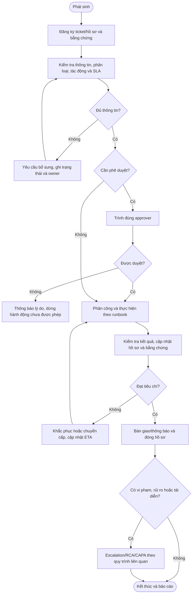

# ITSM-AST-001 — Quản lý tài sản CNTT

**Trạng thái:** DRAFT v1.0 | Owner: IT Asset Owner | Approver: [CẦN CHỐT]

## Phạm vi
Server, NAS, desktop/laptop, monitor, printer, camera/recorder, router/firewall/switch/Wi-Fi, UPS, VM, phone, phụ kiện, license.

## Quy trình vòng đời
1. Nhận đề xuất, xác nhận nhu cầu/cấu hình/ngân sách và phê duyệt.
2. Khi nhận tài sản, kiểm tra model, serial, tình trạng, phụ kiện, hóa đơn/bảo hành.
3. Cấp Asset ID duy nhất. Hồ sơ cũ nêu prefix `MS`, mã loại thiết bị, vùng/người dùng/phòng tùy chọn và số thứ tự.
4. Ghi Asset Register: ID, loại, model, serial, site, phòng, owner/user, vị trí, trạng thái, ngày mua/bảo hành, vendor và liên kết license/ticket.
5. Trước cấp phát, kiểm tra cấu hình, hệ điều hành/phần mềm cho phép và kiểm soát bảo mật.
6. Lập biên bản bàn giao; không ghi mật khẩu.
7. Mượn/trả/đổi phải ghi Check-out/Check-in, người giữ, hạn trả, tình trạng/phụ kiện.
8. Sửa chữa/bảo hành liên kết ticket, vendor, chi phí, ngày gửi/nhận và kết quả.
9. On/offboarding phải thu hồi/đối soát tài sản.
10. Kiểm kê định kỳ; ghi chênh lệch, owner và action.

## Trạng thái
Nguồn nêu `In Use`, `In Store`, `Damaged`. Đề xuất tách trạng thái vòng đời khỏi giao dịch Check-in/Check-out.

## Kiểm soát
Mã không trùng; serial bắt buộc khi có; giữ lịch sử tài sản thanh lý. Dải IP cũ chỉ là gợi ý, không thay thế thiết kế IP/VLAN từng site.

## Kiểm soát vận hành chung
- **Trạng thái:** DỰ THẢO — chỉ có hiệu lực sau phê duyệt theo thẩm quyền MSTAR.
- **Phân biệt nội dung:** thông tin được trích từ hồ sơ nguồn là căn cứ hiện có; kiểm soát bổ sung là đề xuất; các giá trị thiếu phải được chốt trước ban hành.
- **Vai trò:** requester/đơn vị yêu cầu cung cấp thông tin; Service Desk/IT tiếp nhận và điều phối; process owner chịu trách nhiệm chất lượng; approver quyết định theo ma trận thẩm quyền; IT Lead giám sát ngoại lệ và báo cáo.
- **Bằng chứng:** ticket/hồ sơ phải truy xuất được người yêu cầu, người xử lý, thời điểm, phê duyệt, kết quả và liên kết bằng chứng. Không lưu mật khẩu, token, private key hoặc recovery code trong ticket, CSV, email thông thường hay Git.
- **Chuyển quy trình:** gián đoạn dịch vụ liên kết ITSM-INC-001; dấu hiệu ATTT liên kết ITSM-SEC-001; thay đổi production liên kết ITSM-CHG-001; cấp quyền liên kết ITSM-IAM-001; restore liên kết ITSM-BKP-001.

## Lưu đồ

## Luồng công việc đặc thù — ITSM-AST-001 Quản lý tài sản
1. **Kích hoạt:** Mua/nhận/cấp phát/thu hồi/kiểm kê tài sản.
2. **Tiếp nhận/đánh giá:** Kiểm tra phê duyệt, model/serial, tình trạng, phụ kiện, chứng từ.
3. **Kiểm soát:** Gán Asset ID duy nhất và cập nhật Asset Register.
4. **Thực hiện:** Kiểm tra cấu hình và bảo mật trước cấp phát; ký bàn giao.
5. **Xác minh và kết thúc:** Theo dõi di chuyển, mượn-trả, sửa chữa, bảo hành và kiểm kê.
6. **Điều kiện chuyển cấp/ngoại lệ:** Thu hồi, xử lý dữ liệu an toàn và thanh lý theo phê duyệt.
7. **Bằng chứng đặc thù:** Sai serial, thất lạc, thiết bị không owner hoặc sai trạng thái.
8. **KPI đề xuất:** Asset Register, biên bản bàn giao, ticket, bảo hành.

## Hồ sơ, chỉ số và checklist đóng
- **Hồ sơ tối thiểu:** ticket/mã tham chiếu, đầu vào, phân loại, SLA nếu áp dụng, phê duyệt nếu cần, người thực hiện, timeline, kết quả kiểm tra, thông báo/bàn giao và bằng chứng.
- **Nơi lưu/thời hạn:** theo kho lưu và chính sách lưu hồ sơ được MSTAR phê duyệt; không tự đặt thời hạn.
- **Chỉ số:** dùng các KPI đề xuất bên dưới như chỉ số tham khảo; process owner phải xác nhận định nghĩa, nguồn dữ liệu, chu kỳ và mục tiêu trước khi áp dụng chính thức.
- **Checklist đóng:** [ ] đúng requester/owner; [ ] phê duyệt đầy đủ; [ ] kết quả đã kiểm tra; [ ] ticket/register cập nhật; [ ] không chứa secret; [ ] bằng chứng truy xuất được; [ ] vi phạm/tái diễn đã escalation/RCA/CAPA.
- **Điểm cần chốt trước ban hành:** owner/approver và người thay thế; ma trận ưu tiên/escalation; lịch và quy tắc SLA liên quan; ngưỡng kỹ thuật hoặc retention nếu áp dụng; kho hồ sơ/quyền/thời hạn lưu; kiểm thử quy trình và ghi nhận kết quả.
