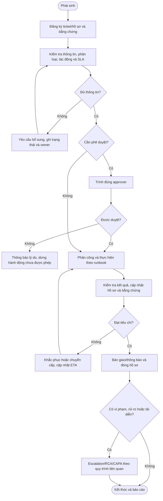

# ITSM-IAM-001 — Quản lý tài khoản và quyền truy cập

**Trạng thái:** DRAFT v1.0 | Owner: System/Data Owner | Approver: [CẦN CHỐT]

## Cấp/sửa quyền
1. Nhận ticket từ manager/HR/owner với danh tính, vai trò, mục đích, hệ thống, quyền và thời hạn.
2. System/Data Owner phê duyệt trước cấp quyền; quyền admin/dữ liệu nhạy cảm cần approval bổ sung.
3. Cấp qua role/group theo least privilege; bật MFA nếu hỗ trợ.
4. Bàn giao thông tin khởi tạo qua kênh an toàn; người dùng tự quản lý thông tin xác thực.
5. Ghi quyền, người thực hiện, thời gian hiệu lực và bằng chứng.
6. Khi chuyển vị trí, thu hồi quyền không còn cần rồi cấp quyền mới sau phê duyệt.
7. Rà soát định kỳ tài khoản không dùng, quyền đặc quyền, service/shared accounts và ngoại lệ.

## Thu hồi
Theo xác nhận HR/manager: khóa quyền đúng thời điểm; thu hồi VPN/SSO/email/SaaS/token/API key/vendor access; thu hồi thiết bị/license; chuyển giao dữ liệu công việc theo phê duyệt; ghi ngoại lệ, owner và deadline.

## Kiểm soát
Không lưu password/token/private key/recovery code trong GitHub, Excel, ticket hoặc biên bản. Shared account phải có owner và kiểm soát. Chính sách cũ 8 ký tự/đổi 60 ngày/khóa vĩnh viễn cần được thay bằng chính sách hiện hành đã duyệt.

## Kiểm soát vận hành chung
- **Trạng thái:** DỰ THẢO — chỉ có hiệu lực sau phê duyệt theo thẩm quyền MSTAR.
- **Phân biệt nội dung:** thông tin được trích từ hồ sơ nguồn là căn cứ hiện có; kiểm soát bổ sung là đề xuất; các giá trị thiếu phải được chốt trước ban hành.
- **Vai trò:** requester/đơn vị yêu cầu cung cấp thông tin; Service Desk/IT tiếp nhận và điều phối; process owner chịu trách nhiệm chất lượng; approver quyết định theo ma trận thẩm quyền; IT Lead giám sát ngoại lệ và báo cáo.
- **Bằng chứng:** ticket/hồ sơ phải truy xuất được người yêu cầu, người xử lý, thời điểm, phê duyệt, kết quả và liên kết bằng chứng. Không lưu mật khẩu, token, private key hoặc recovery code trong ticket, CSV, email thông thường hay Git.
- **Chuyển quy trình:** gián đoạn dịch vụ liên kết ITSM-INC-001; dấu hiệu ATTT liên kết ITSM-SEC-001; thay đổi production liên kết ITSM-CHG-001; cấp quyền liên kết ITSM-IAM-001; restore liên kết ITSM-BKP-001.

## Lưu đồ

## Luồng công việc đặc thù — ITSM-IAM-001 Tài khoản và quyền
1. **Kích hoạt:** HR/manager/owner gửi yêu cầu xác thực.
2. **Tiếp nhận/đánh giá:** Xác minh danh tính, vai trò, hệ thống, quyền, mục đích, thời hạn.
3. **Kiểm soát:** Owner phê duyệt trước cấp; quyền đặc quyền cần phê duyệt tăng cường.
4. **Thực hiện:** Cấp theo role/group, least privilege, MFA nếu hỗ trợ.
5. **Xác minh và kết thúc:** Khi mover/leaver phải rà soát và thu hồi quyền đúng thời điểm.
6. **Điều kiện chuyển cấp/ngoại lệ:** Kiểm tra log và xác nhận hoàn tất.
7. **Bằng chứng đặc thù:** Yêu cầu không xác thực, quyền admin, shared account/khẩn cấp.
8. **KPI đề xuất:** Access Request, approvals, logs cấp/thu hồi, review.

## Hồ sơ, chỉ số và checklist đóng
- **Hồ sơ tối thiểu:** ticket/mã tham chiếu, đầu vào, phân loại, SLA nếu áp dụng, phê duyệt nếu cần, người thực hiện, timeline, kết quả kiểm tra, thông báo/bàn giao và bằng chứng.
- **Nơi lưu/thời hạn:** theo kho lưu và chính sách lưu hồ sơ được MSTAR phê duyệt; không tự đặt thời hạn.
- **Chỉ số:** dùng các KPI đề xuất bên dưới như chỉ số tham khảo; process owner phải xác nhận định nghĩa, nguồn dữ liệu, chu kỳ và mục tiêu trước khi áp dụng chính thức.
- **Checklist đóng:** [ ] đúng requester/owner; [ ] phê duyệt đầy đủ; [ ] kết quả đã kiểm tra; [ ] ticket/register cập nhật; [ ] không chứa secret; [ ] bằng chứng truy xuất được; [ ] vi phạm/tái diễn đã escalation/RCA/CAPA.
- **Điểm cần chốt trước ban hành:** owner/approver và người thay thế; ma trận ưu tiên/escalation; lịch và quy tắc SLA liên quan; ngưỡng kỹ thuật hoặc retention nếu áp dụng; kho hồ sơ/quyền/thời hạn lưu; kiểm thử quy trình và ghi nhận kết quả.
