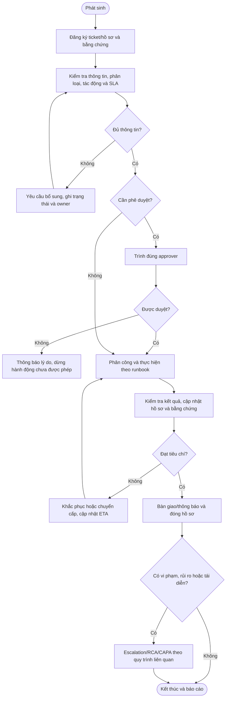

# ITSM-FS-001 — File Server và quản lý dữ liệu

**Trạng thái:** DRAFT v1.0 | Owner: File Server/Data Owner | Approver: [CẦN CHỐT]

## Bối cảnh hồ sơ nguồn
Tài liệu hiện có mô tả PUBLIC toàn công ty, thư mục PUBLIC theo phòng và thư mục cá nhân; dữ liệu công việc lưu tập trung trên ổ mạng. Cấu trúc thực tế cần đối chiếu.

## Cấp/sửa quyền
1. Ticket ghi requester, đường dẫn, user/group, mục đích, quyền Read/Modify/Full Control và thời hạn nếu tạm thời.
2. Data Owner/Manager phê duyệt ACL change.
3. Ưu tiên group-based permissions, hạn chế quyền trực tiếp từng người nếu có thể.
4. Kiểm tra ACL/kế thừa và xác minh người ngoài phạm vi không truy cập.
5. Ghi log thay đổi và ticket.
6. Rà soát quyền định kỳ và khi nhân viên chuyển/nghỉ.

## Vận hành/restore
Theo dõi dung lượng, volume, share, log, backup và cảnh báo. Yêu cầu restore phải xác minh requester, đường dẫn/thời điểm và approval nếu có nguy cơ ghi đè. Kiểm tra tính toàn vẹn, quyền và xác nhận kết quả.

## Kiểm soát
Không dùng share local làm kho chính nếu chính sách yêu cầu ổ mạng. Không coi danh sách định dạng file cũ là biện pháp bảo mật duy nhất. Không ghi secrets trong tài liệu.

## Kiểm soát vận hành chung
- **Trạng thái:** DỰ THẢO — chỉ có hiệu lực sau phê duyệt theo thẩm quyền MSTAR.
- **Phân biệt nội dung:** thông tin được trích từ hồ sơ nguồn là căn cứ hiện có; kiểm soát bổ sung là đề xuất; các giá trị thiếu phải được chốt trước ban hành.
- **Vai trò:** requester/đơn vị yêu cầu cung cấp thông tin; Service Desk/IT tiếp nhận và điều phối; process owner chịu trách nhiệm chất lượng; approver quyết định theo ma trận thẩm quyền; IT Lead giám sát ngoại lệ và báo cáo.
- **Bằng chứng:** ticket/hồ sơ phải truy xuất được người yêu cầu, người xử lý, thời điểm, phê duyệt, kết quả và liên kết bằng chứng. Không lưu mật khẩu, token, private key hoặc recovery code trong ticket, CSV, email thông thường hay Git.
- **Chuyển quy trình:** gián đoạn dịch vụ liên kết ITSM-INC-001; dấu hiệu ATTT liên kết ITSM-SEC-001; thay đổi production liên kết ITSM-CHG-001; cấp quyền liên kết ITSM-IAM-001; restore liên kết ITSM-BKP-001.

## Lưu đồ

## Luồng công việc đặc thù — ITSM-FS-001 File Server và dữ liệu
1. **Kích hoạt:** Tạo thư mục, đổi ACL, chia sẻ hoặc restore.
2. **Tiếp nhận/đánh giá:** Ghi đường dẫn, owner dữ liệu, người/nhóm, quyền và thời hạn.
3. **Kiểm soát:** Data Owner/Manager phê duyệt; ưu tiên group-based ACL.
4. **Thực hiện:** Kiểm tra ACL/kế thừa và xác minh người ngoài phạm vi không truy cập.
5. **Xác minh và kết thúc:** Theo dõi dung lượng, share, log và restore theo BKP.
6. **Điều kiện chuyển cấp/ngoại lệ:** Lưu bằng chứng, thông báo và rà soát quyền.
7. **Bằng chứng đặc thù:** Quyền rộng, dữ liệu nhạy cảm, mất/xóa dữ liệu, owner không rõ.
8. **KPI đề xuất:** Ticket, approval, ACL before/after, restore evidence.

## Hồ sơ, chỉ số và checklist đóng
- **Hồ sơ tối thiểu:** ticket/mã tham chiếu, đầu vào, phân loại, SLA nếu áp dụng, phê duyệt nếu cần, người thực hiện, timeline, kết quả kiểm tra, thông báo/bàn giao và bằng chứng.
- **Nơi lưu/thời hạn:** theo kho lưu và chính sách lưu hồ sơ được MSTAR phê duyệt; không tự đặt thời hạn.
- **Chỉ số:** dùng các KPI đề xuất bên dưới như chỉ số tham khảo; process owner phải xác nhận định nghĩa, nguồn dữ liệu, chu kỳ và mục tiêu trước khi áp dụng chính thức.
- **Checklist đóng:** [ ] đúng requester/owner; [ ] phê duyệt đầy đủ; [ ] kết quả đã kiểm tra; [ ] ticket/register cập nhật; [ ] không chứa secret; [ ] bằng chứng truy xuất được; [ ] vi phạm/tái diễn đã escalation/RCA/CAPA.
- **Điểm cần chốt trước ban hành:** owner/approver và người thay thế; ma trận ưu tiên/escalation; lịch và quy tắc SLA liên quan; ngưỡng kỹ thuật hoặc retention nếu áp dụng; kho hồ sơ/quyền/thời hạn lưu; kiểm thử quy trình và ghi nhận kết quả.
