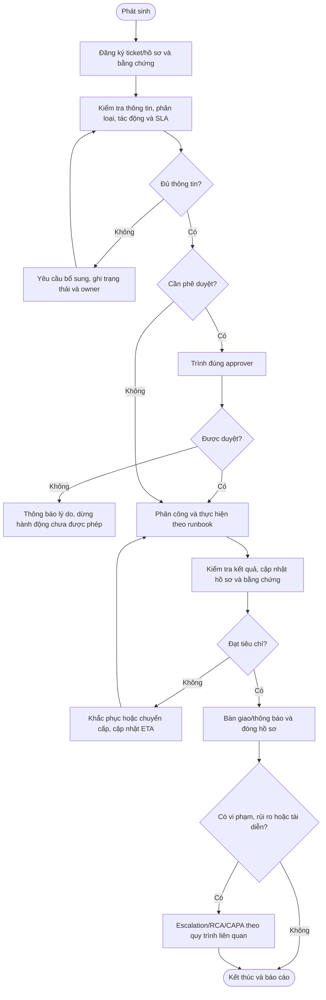

# ITSM-CHG-001 — Quản lý thay đổi

**Trạng thái:** DRAFT v1.0 | Owner: IT Lead/Change Owner | Approver: [CẦN CHỐT]

## Phạm vi
Thay đổi production: firewall/VPN/DNS/IP/VLAN, server/VM, NAS/share, OS/app, backup, monitoring, quyền đặc quyền và cấu hình có tác động dịch vụ.

## Quy trình
1. Tạo Change Request liên kết ticket, ghi lý do, phạm vi, CI/service, rủi ro, tác động và cửa sổ.
2. Phân loại Standard/Normal/Emergency theo tiêu chí đã duyệt.
3. Đánh giá phụ thuộc, downtime, security, backup và truyền thông.
4. Ghi từng bước triển khai, tiêu chí thành công, kiểm thử và rollback.
5. Lấy phê duyệt owner/IT Lead/CAB theo rủi ro.
6. Thông báo bên liên quan.
7. Triển khai và ghi timestamps, người làm, log và sai lệch.
8. Kiểm thử, cập nhật inventory/sơ đồ/runbook/tài liệu.
9. Đóng change; failed/emergency/high-risk cần post-review và action items.

## Emergency change
Ghi người phê duyệt khẩn, lý do, biện pháp giảm rủi ro và hậu kiểm theo thời hạn [CẦN CHỐT]. Không thực hiện change vượt quyền; change thất bại phải có rollback/restore và incident ticket nếu gây ảnh hưởng.

## Kiểm soát vận hành chung
- **Trạng thái:** DỰ THẢO — chỉ có hiệu lực sau phê duyệt theo thẩm quyền MSTAR.
- **Phân biệt nội dung:** thông tin được trích từ hồ sơ nguồn là căn cứ hiện có; kiểm soát bổ sung là đề xuất; các giá trị thiếu phải được chốt trước ban hành.
- **Vai trò:** requester/đơn vị yêu cầu cung cấp thông tin; Service Desk/IT tiếp nhận và điều phối; process owner chịu trách nhiệm chất lượng; approver quyết định theo ma trận thẩm quyền; IT Lead giám sát ngoại lệ và báo cáo.
- **Bằng chứng:** ticket/hồ sơ phải truy xuất được người yêu cầu, người xử lý, thời điểm, phê duyệt, kết quả và liên kết bằng chứng. Không lưu mật khẩu, token, private key hoặc recovery code trong ticket, CSV, email thông thường hay Git.
- **Chuyển quy trình:** gián đoạn dịch vụ liên kết ITSM-INC-001; dấu hiệu ATTT liên kết ITSM-SEC-001; thay đổi production liên kết ITSM-CHG-001; cấp quyền liên kết ITSM-IAM-001; restore liên kết ITSM-BKP-001.

## Lưu đồ

## Luồng công việc đặc thù — ITSM-CHG-001 Quản lý thay đổi
1. **Kích hoạt:** Thay đổi cấu hình/hệ thống/dịch vụ production.
2. **Tiếp nhận/đánh giá:** Tạo Change Request, liên kết ticket/CI, mục tiêu và cửa sổ.
3. **Kiểm soát:** Đánh giá rủi ro, phụ thuộc, downtime, bảo mật, backup và truyền thông.
4. **Thực hiện:** Ghi kế hoạch, kiểm thử, tiêu chí thành công và rollback.
5. **Xác minh và kết thúc:** Xin phê duyệt owner/IT Lead/CAB theo ma trận.
6. **Điều kiện chuyển cấp/ngoại lệ:** Triển khai, kiểm tra, cập nhật inventory/runbook và review.
7. **Bằng chứng đặc thù:** Test fail, rollback, emergency change.
8. **KPI đề xuất:** Change Request, approval, test evidence, logs, PIR.

## Hồ sơ, chỉ số và checklist đóng
- **Hồ sơ tối thiểu:** ticket/mã tham chiếu, đầu vào, phân loại, SLA nếu áp dụng, phê duyệt nếu cần, người thực hiện, timeline, kết quả kiểm tra, thông báo/bàn giao và bằng chứng.
- **Nơi lưu/thời hạn:** theo kho lưu và chính sách lưu hồ sơ được MSTAR phê duyệt; không tự đặt thời hạn.
- **Chỉ số:** dùng các KPI đề xuất bên dưới như chỉ số tham khảo; process owner phải xác nhận định nghĩa, nguồn dữ liệu, chu kỳ và mục tiêu trước khi áp dụng chính thức.
- **Checklist đóng:** [ ] đúng requester/owner; [ ] phê duyệt đầy đủ; [ ] kết quả đã kiểm tra; [ ] ticket/register cập nhật; [ ] không chứa secret; [ ] bằng chứng truy xuất được; [ ] vi phạm/tái diễn đã escalation/RCA/CAPA.
- **Điểm cần chốt trước ban hành:** owner/approver và người thay thế; ma trận ưu tiên/escalation; lịch và quy tắc SLA liên quan; ngưỡng kỹ thuật hoặc retention nếu áp dụng; kho hồ sơ/quyền/thời hạn lưu; kiểm thử quy trình và ghi nhận kết quả.
