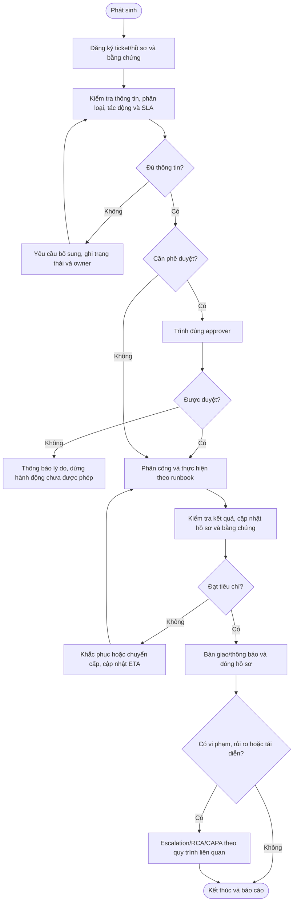

# ITSM-MON-001 — Giám sát và xử lý cảnh báo Zabbix

**Trạng thái:** DRAFT v1.0 | Owner: Monitoring Owner | Approver: [CẦN CHỐT]

## Đăng ký host
1. Xác nhận asset/service và owner.
2. Đặt hostname theo site/khách hàng/CI; gán group/template/criticality.
3. Chọn Agent, SNMP hoặc ICMP theo thiết bị và thiết kế bảo mật.
4. Ghi IP/DNS, version/template, alert channel, maintenance window và runbook.
5. Kiểm tra dữ liệu, trigger và notification.

## Bảo mật
Hồ sơ nguồn có community SNMP cố định và hướng dẫn NAT UDP/161; cần rà soát trước khi áp dụng. Ưu tiên SNMPv3, VPN/ACL allowlist và phân đoạn mạng; tránh mở SNMP/agent trực tiếp ra Internet. Secrets ở vault, không commit community/password. Xác minh phiên bản Zabbix/agent thực tế.

## Xử lý alert
1. Xác định severity, host/service, tác động và owner.
2. Xác nhận; tạo/liên kết ticket khi cần hành động.
3. Chẩn đoán, cập nhật timeline, workaround và ETA.
4. Xác minh dữ liệu monitoring trở lại; đóng ticket/alert theo quy tắc.
5. Alert lặp/noise cần rà soát trigger/runbook bằng change có kiểm soát.
6. Rà soát host mất dữ liệu, agent lỗi, notification và thiết bị trọng yếu chưa monitor.

## Kiểm soát vận hành chung
- **Trạng thái:** DỰ THẢO — chỉ có hiệu lực sau phê duyệt theo thẩm quyền MSTAR.
- **Phân biệt nội dung:** thông tin được trích từ hồ sơ nguồn là căn cứ hiện có; kiểm soát bổ sung là đề xuất; các giá trị thiếu phải được chốt trước ban hành.
- **Vai trò:** requester/đơn vị yêu cầu cung cấp thông tin; Service Desk/IT tiếp nhận và điều phối; process owner chịu trách nhiệm chất lượng; approver quyết định theo ma trận thẩm quyền; IT Lead giám sát ngoại lệ và báo cáo.
- **Bằng chứng:** ticket/hồ sơ phải truy xuất được người yêu cầu, người xử lý, thời điểm, phê duyệt, kết quả và liên kết bằng chứng. Không lưu mật khẩu, token, private key hoặc recovery code trong ticket, CSV, email thông thường hay Git.
- **Chuyển quy trình:** gián đoạn dịch vụ liên kết ITSM-INC-001; dấu hiệu ATTT liên kết ITSM-SEC-001; thay đổi production liên kết ITSM-CHG-001; cấp quyền liên kết ITSM-IAM-001; restore liên kết ITSM-BKP-001.

## Lưu đồ

## Luồng công việc đặc thù — ITSM-MON-001 Giám sát Zabbix
1. **Kích hoạt:** Đăng ký host hoặc phát sinh alert.
2. **Tiếp nhận/đánh giá:** Xác minh host/service, owner, criticality, template và kênh cảnh báo.
3. **Kiểm soát:** Cấu hình Agent/SNMP/ICMP theo thiết kế được duyệt.
4. **Thực hiện:** Kiểm tra dữ liệu, trigger, notification và maintenance window.
5. **Xác minh và kết thúc:** Alert phải được acknowledge, đánh giá tác động, link ticket và giao owner.
6. **Điều kiện chuyển cấp/ngoại lệ:** Xác minh phục hồi; cập nhật host/template qua change khi cần.
7. **Bằng chứng đặc thù:** Mất monitoring, alert storm, host không owner, secret lộ.
8. **KPI đề xuất:** Host Register, alert history, ticket, change record.

## Hồ sơ, chỉ số và checklist đóng
- **Hồ sơ tối thiểu:** ticket/mã tham chiếu, đầu vào, phân loại, SLA nếu áp dụng, phê duyệt nếu cần, người thực hiện, timeline, kết quả kiểm tra, thông báo/bàn giao và bằng chứng.
- **Nơi lưu/thời hạn:** theo kho lưu và chính sách lưu hồ sơ được MSTAR phê duyệt; không tự đặt thời hạn.
- **Chỉ số:** dùng các KPI đề xuất bên dưới như chỉ số tham khảo; process owner phải xác nhận định nghĩa, nguồn dữ liệu, chu kỳ và mục tiêu trước khi áp dụng chính thức.
- **Checklist đóng:** [ ] đúng requester/owner; [ ] phê duyệt đầy đủ; [ ] kết quả đã kiểm tra; [ ] ticket/register cập nhật; [ ] không chứa secret; [ ] bằng chứng truy xuất được; [ ] vi phạm/tái diễn đã escalation/RCA/CAPA.
- **Điểm cần chốt trước ban hành:** owner/approver và người thay thế; ma trận ưu tiên/escalation; lịch và quy tắc SLA liên quan; ngưỡng kỹ thuật hoặc retention nếu áp dụng; kho hồ sơ/quyền/thời hạn lưu; kiểm thử quy trình và ghi nhận kết quả.
