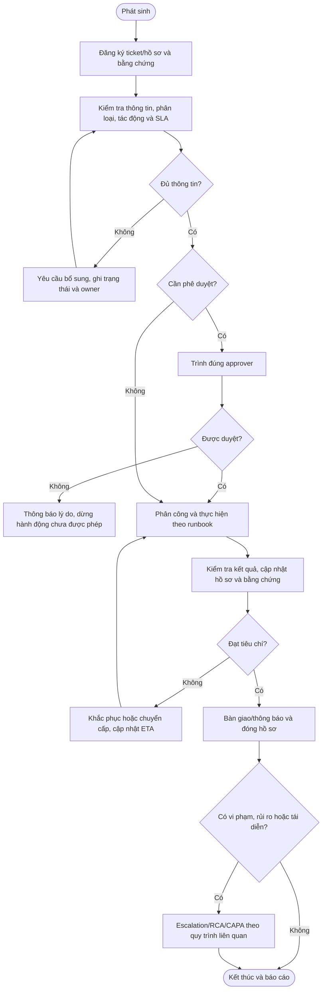

# ITSM-BKP-001 — Sao lưu và khôi phục

**Trạng thái:** DRAFT v1.0 | Owner: Backup Owner | Approver: Service Owner

## Kế hoạch
1. Liệt kê hệ thống/dữ liệu, owner, criticality và phụ thuộc.
2. Chốt RPO/RTO, tần suất, retention, vị trí bản sao theo dịch vụ [CẦN CHỐT].
3. Tách backup khỏi production; cân nhắc immutable/offline copy khi khả thi.
4. Quản lý credential backup trong vault và quyền tối thiểu.
5. Lập lịch kiểm tra job và restore test.

## Giám sát
Kiểm tra job/log/dung lượng. Job fail phải tạo ticket, đánh giá backup gap, gán owner và theo dõi tới khi backup chạy thành công.

## Restore
1. Xác minh requester và approval owner.
2. Xác định dữ liệu/điểm khôi phục, nguy cơ ghi đè và vị trí đích.
3. Chọn bản sao phù hợp và giữ log.
4. Khôi phục theo runbook; không ghi đè production khi chưa có approval rõ.
5. Kiểm tra integrity, quyền và chức năng ứng dụng.
6. Xác nhận kết quả, thời gian và evidence.

Restore test phải theo lịch/criticality; job backup xanh không chứng minh chắc chắn khả năng phục hồi.

## Kiểm soát vận hành chung
- **Trạng thái:** DỰ THẢO — chỉ có hiệu lực sau phê duyệt theo thẩm quyền MSTAR.
- **Phân biệt nội dung:** thông tin được trích từ hồ sơ nguồn là căn cứ hiện có; kiểm soát bổ sung là đề xuất; các giá trị thiếu phải được chốt trước ban hành.
- **Vai trò:** requester/đơn vị yêu cầu cung cấp thông tin; Service Desk/IT tiếp nhận và điều phối; process owner chịu trách nhiệm chất lượng; approver quyết định theo ma trận thẩm quyền; IT Lead giám sát ngoại lệ và báo cáo.
- **Bằng chứng:** ticket/hồ sơ phải truy xuất được người yêu cầu, người xử lý, thời điểm, phê duyệt, kết quả và liên kết bằng chứng. Không lưu mật khẩu, token, private key hoặc recovery code trong ticket, CSV, email thông thường hay Git.
- **Chuyển quy trình:** gián đoạn dịch vụ liên kết ITSM-INC-001; dấu hiệu ATTT liên kết ITSM-SEC-001; thay đổi production liên kết ITSM-CHG-001; cấp quyền liên kết ITSM-IAM-001; restore liên kết ITSM-BKP-001.

## Lưu đồ

## Luồng công việc đặc thù — ITSM-BKP-001 Backup và Restore
1. **Kích hoạt:** Backup job theo lịch hoặc yêu cầu restore.
2. **Tiếp nhận/đánh giá:** Xác định dữ liệu, owner, RPO/RTO/retention đã duyệt.
3. **Kiểm soát:** Kiểm tra job, log, dung lượng và bản sao.
4. **Thực hiện:** Job fail phải tạo ticket, đánh giá backup gap và giao owner.
5. **Xác minh và kết thúc:** Restore phải xác minh requester, approval, điểm khôi phục và đích.
6. **Điều kiện chuyển cấp/ngoại lệ:** Kiểm tra tính toàn vẹn, lưu kết quả và thông báo owner.
7. **Bằng chứng đặc thù:** Backup fail, thiếu bản sao, restore có nguy cơ ghi đè/ransomware.
8. **KPI đề xuất:** Backup logs, ticket, approval, restore test evidence.

## Hồ sơ, chỉ số và checklist đóng
- **Hồ sơ tối thiểu:** ticket/mã tham chiếu, đầu vào, phân loại, SLA nếu áp dụng, phê duyệt nếu cần, người thực hiện, timeline, kết quả kiểm tra, thông báo/bàn giao và bằng chứng.
- **Nơi lưu/thời hạn:** theo kho lưu và chính sách lưu hồ sơ được MSTAR phê duyệt; không tự đặt thời hạn.
- **Chỉ số:** dùng các KPI đề xuất bên dưới như chỉ số tham khảo; process owner phải xác nhận định nghĩa, nguồn dữ liệu, chu kỳ và mục tiêu trước khi áp dụng chính thức.
- **Checklist đóng:** [ ] đúng requester/owner; [ ] phê duyệt đầy đủ; [ ] kết quả đã kiểm tra; [ ] ticket/register cập nhật; [ ] không chứa secret; [ ] bằng chứng truy xuất được; [ ] vi phạm/tái diễn đã escalation/RCA/CAPA.
- **Điểm cần chốt trước ban hành:** owner/approver và người thay thế; ma trận ưu tiên/escalation; lịch và quy tắc SLA liên quan; ngưỡng kỹ thuật hoặc retention nếu áp dụng; kho hồ sơ/quyền/thời hạn lưu; kiểm thử quy trình và ghi nhận kết quả.
