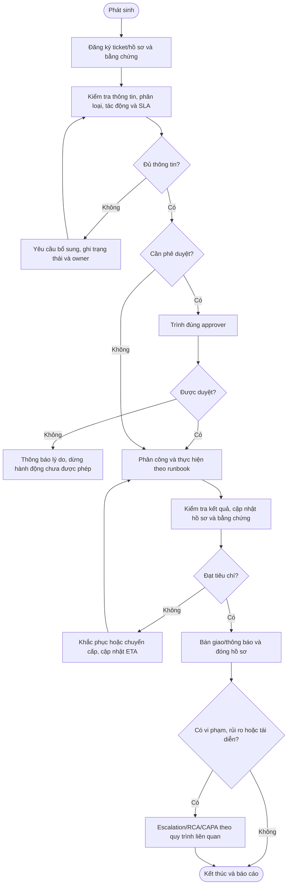

# ITSM-SEC-001 — Sự kiện an ninh thông tin

**Trạng thái:** DRAFT v1.0 | Owner: Security Owner/IT Lead | Approver: [CẦN CHỐT]

## Kích hoạt
Mã độc, phishing, tài khoản bị chiếm, dữ liệu rò rỉ/gửi nhầm, truy cập bất thường, thiết bị thất lạc, secret lộ hoặc cảnh báo nghiêm trọng.

## Quy trình
1. Mở ticket hạn chế quyền; ghi thời gian, nguồn phát hiện, hệ thống/tài khoản/thiết bị và bằng chứng.
2. Đánh giá mức độ/phạm vi; thông báo người có thẩm quyền theo ma trận [CẦN CHỐT].
3. Cô lập thiết bị/tài khoản hoặc chặn truy cập khi cần; cân nhắc bảo toàn chứng cứ.
4. Không xóa log, format máy hoặc sửa bằng chứng trước khi được hướng dẫn.
5. Thu hồi/rotate secret bị lộ, chặn dấu hiệu tấn công, vá lỗi hoặc khôi phục hệ thống sạch theo phê duyệt.
6. Xác định dữ liệu/hệ thống ảnh hưởng, phối hợp vendor và bên liên quan.
7. Khôi phục có kiểm soát và tăng cường monitoring.
8. Lập RCA, corrective actions, owner/hạn; cập nhật quy trình và monitoring.

## Kiểm soát
Không ghi secret vào ticket. Chỉ người được ủy quyền trao đổi bên ngoài. Nghĩa vụ thông báo theo pháp luật/hợp đồng cần được xác nhận với bộ phận phụ trách.

## Kiểm soát vận hành chung
- **Trạng thái:** DỰ THẢO — chỉ có hiệu lực sau phê duyệt theo thẩm quyền MSTAR.
- **Phân biệt nội dung:** thông tin được trích từ hồ sơ nguồn là căn cứ hiện có; kiểm soát bổ sung là đề xuất; các giá trị thiếu phải được chốt trước ban hành.
- **Vai trò:** requester/đơn vị yêu cầu cung cấp thông tin; Service Desk/IT tiếp nhận và điều phối; process owner chịu trách nhiệm chất lượng; approver quyết định theo ma trận thẩm quyền; IT Lead giám sát ngoại lệ và báo cáo.
- **Bằng chứng:** ticket/hồ sơ phải truy xuất được người yêu cầu, người xử lý, thời điểm, phê duyệt, kết quả và liên kết bằng chứng. Không lưu mật khẩu, token, private key hoặc recovery code trong ticket, CSV, email thông thường hay Git.
- **Chuyển quy trình:** gián đoạn dịch vụ liên kết ITSM-INC-001; dấu hiệu ATTT liên kết ITSM-SEC-001; thay đổi production liên kết ITSM-CHG-001; cấp quyền liên kết ITSM-IAM-001; restore liên kết ITSM-BKP-001.

## Lưu đồ

## Luồng công việc đặc thù — ITSM-SEC-001 Sự kiện an toàn thông tin
1. **Kích hoạt:** Phát hiện phishing/malware/chiếm tài khoản/rò rỉ.
2. **Tiếp nhận/đánh giá:** Tạo ticket hạn chế quyền, ghi thời gian, nguồn, phạm vi và evidence.
3. **Kiểm soát:** Đánh giá severity theo ma trận đã duyệt; thông báo đúng thẩm quyền.
4. **Thực hiện:** Cô lập thiết bị/tài khoản khi cần và bảo toàn log/chứng cứ.
5. **Xác minh và kết thúc:** Loại bỏ nguyên nhân, rotate secret, vá/khôi phục theo phê duyệt.
6. **Điều kiện chuyển cấp/ngoại lệ:** Xác minh sạch, RCA/CAPA và thông báo theo thẩm quyền.
7. **Bằng chứng đặc thù:** Lộ dữ liệu, diện rộng, nghi vấn pháp lý, nguy cơ mất chứng cứ.
8. **KPI đề xuất:** Security record, logs, chain of custody, approvals, RCA.

## Hồ sơ, chỉ số và checklist đóng
- **Hồ sơ tối thiểu:** ticket/mã tham chiếu, đầu vào, phân loại, SLA nếu áp dụng, phê duyệt nếu cần, người thực hiện, timeline, kết quả kiểm tra, thông báo/bàn giao và bằng chứng.
- **Nơi lưu/thời hạn:** theo kho lưu và chính sách lưu hồ sơ được MSTAR phê duyệt; không tự đặt thời hạn.
- **Chỉ số:** dùng các KPI đề xuất bên dưới như chỉ số tham khảo; process owner phải xác nhận định nghĩa, nguồn dữ liệu, chu kỳ và mục tiêu trước khi áp dụng chính thức.
- **Checklist đóng:** [ ] đúng requester/owner; [ ] phê duyệt đầy đủ; [ ] kết quả đã kiểm tra; [ ] ticket/register cập nhật; [ ] không chứa secret; [ ] bằng chứng truy xuất được; [ ] vi phạm/tái diễn đã escalation/RCA/CAPA.
- **Điểm cần chốt trước ban hành:** owner/approver và người thay thế; ma trận ưu tiên/escalation; lịch và quy tắc SLA liên quan; ngưỡng kỹ thuật hoặc retention nếu áp dụng; kho hồ sơ/quyền/thời hạn lưu; kiểm thử quy trình và ghi nhận kết quả.
