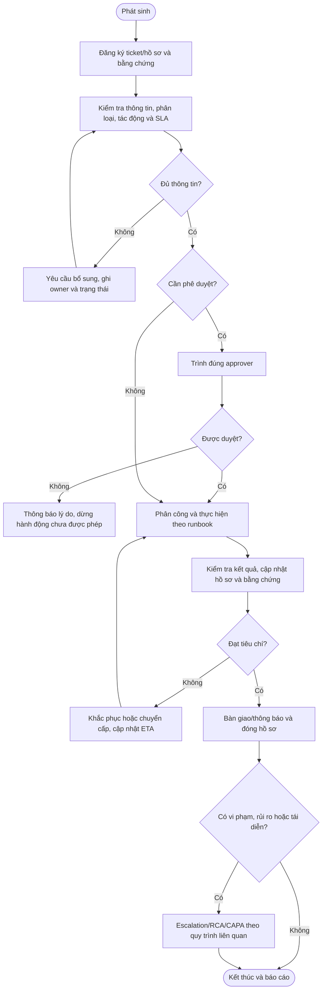

# ITSM-VND-001 — Nhà cung cấp, hợp đồng, domain/SSL và license

**Trạng thái:** DRAFT v1.0 | Owner: Service Owner/Procurement/IT Lead | Approver: [CẦN CHỐT]

## Đăng ký
Ghi Service ID, owner, vendor/đầu mối, hợp đồng/PO ref, ngày bắt đầu/kết thúc, SLA, chi phí, renewal date, domain/SSL/license, dữ liệu xử lý và mức truy cập.

## Mua mới/gia hạn
1. Ticket nêu nhu cầu, phạm vi, người dùng, thời hạn và ngân sách.
2. Owner/Procurement phê duyệt.
3. Kiểm tra license terms, số lượng, support, SLA, điều khoản dữ liệu/chấm dứt và export.
4. Đăng ký ngày hết hạn và mốc nhắc theo quy định được duyệt [CẦN CHỐT].
5. Đối soát license mua/đã gán/còn trống và bằng chứng gia hạn.

## Vendor access
Cần ticket, approval owner, tài khoản riêng, least privilege, MFA/VPN, thời hạn, người giám sát và xác nhận thu hồi sau hoàn tất.

## Kết thúc dịch vụ
Thu hồi tài khoản/token/VPN; xác nhận xuất/xóa dữ liệu theo hợp đồng; chuyển giao cấu hình/tài sản và cập nhật register.

Nhãn “Free” trong checklist cũ không chứng minh mọi cách sử dụng đều miễn phí; phải xác minh license/terms hiện hành.

## Kiểm soát vận hành chung
- **Trạng thái:** DỰ THẢO — chỉ có hiệu lực sau phê duyệt theo thẩm quyền MSTAR.
- **Phân biệt nội dung:** thông tin trong hồ sơ nguồn là căn cứ hiện có; kiểm soát bổ sung là đề xuất; giá trị thiếu phải được chốt trước ban hành.
- **Vai trò:** requester/đơn vị yêu cầu cung cấp thông tin; Service Desk/IT tiếp nhận và điều phối; process owner chịu trách nhiệm chất lượng; approver quyết định theo ma trận thẩm quyền; IT Lead giám sát ngoại lệ và báo cáo.
- **Bằng chứng:** hồ sơ truy xuất được người yêu cầu, người xử lý, thời điểm, phê duyệt, kết quả và liên kết bằng chứng. Không lưu mật khẩu, token, private key hoặc recovery code trong ticket, CSV, email thông thường hay Git.
- **Chuyển quy trình:** gián đoạn dịch vụ liên kết ITSM-INC-001; dấu hiệu ATTT liên kết ITSM-SEC-001; thay đổi production liên kết ITSM-CHG-001; cấp quyền liên kết ITSM-IAM-001; restore liên kết ITSM-BKP-001.

## Lưu đồ

## Luồng công việc đặc thù — ITSM-VND-001 Nhà cung cấp và license
1. **Kích hoạt:** Mua mới/gia hạn/vendor access/sự cố vendor.
2. **Tiếp nhận/đánh giá:** Đăng ký owner, vendor, hợp đồng, SLA, chi phí và ngày hết hạn.
3. **Kiểm soát:** Kiểm tra license terms, xử lý dữ liệu, hỗ trợ, chấm dứt và export.
4. **Thực hiện:** Phê duyệt mua/gia hạn; đặt nhắc hạn theo lịch được duyệt.
5. **Xác minh/kết thúc:** Vendor access riêng, least privilege, MFA/VPN, thời hạn và giám sát.
6. **Ngoại lệ/chuyển cấp:** Đối soát license, đánh giá dịch vụ và thu hồi access khi kết thúc.
7. **Bằng chứng đặc thù:** Sắp hết hạn, vendor vi phạm SLA, quyền ngoài hạn/rủi ro dữ liệu.
8. **KPI đề xuất:** Vendor Register, contract ref, approval, renewal/access evidence.

## Hồ sơ, chỉ số và checklist đóng
- **Hồ sơ tối thiểu:** mã tham chiếu, đầu vào, phân loại, SLA nếu áp dụng, phê duyệt nếu cần, người thực hiện, timeline, kết quả kiểm tra, thông báo/bàn giao và bằng chứng.
- **Nơi lưu/thời hạn:** theo kho lưu và chính sách MSTAR được phê duyệt; không tự đặt thời hạn.
- **KPI đề xuất:** chỉ dùng sau khi process owner xác nhận định nghĩa, nguồn dữ liệu, chu kỳ và mục tiêu.
- **Checklist đóng:** [ ] đúng requester/owner; [ ] phê duyệt đầy đủ; [ ] kết quả kiểm tra; [ ] ticket/register cập nhật; [ ] không chứa secret; [ ] bằng chứng truy xuất được; [ ] vi phạm/tái diễn đã escalation/RCA/CAPA.
- **Cần chốt trước ban hành:** owner/approver; ma trận SLA/escalation; ngưỡng kỹ thuật/retention nếu áp dụng; kho hồ sơ/quyền/thời hạn lưu; kết quả kiểm thử quy trình.
