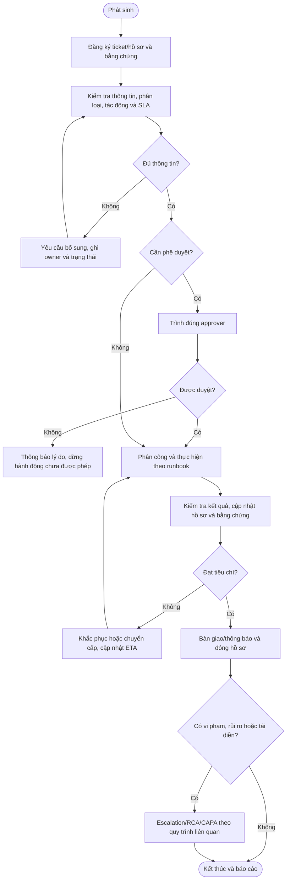

# ITSM-OPS-001 — Kiểm tra vận hành hằng ngày

**Trạng thái:** DRAFT v1.0 | Owner: IT System/Network | Approver: IT Lead

## Phạm vi
Server/VM, NAS/volume/share, backup, AD/DNS/DHCP, email, router/firewall/WAN/VPN, switch/uplink, Wi-Fi/controller/AP, Zabbix/alert channel và dịch vụ trọng yếu.

## Thực hiện
1. Kiểm tra theo lịch được phân công.
2. Ghi timestamp, người kiểm tra, site, hệ thống, ngưỡng, giá trị quan sát, Pass/Fail/NA và evidence.
3. Dùng ngưỡng đã duyệt theo từng hệ thống; không đặt một ngưỡng chung cho tất cả.
4. Mọi Fail/out-of-threshold cần ticket/alert, severity, owner và bước xử lý.
5. Rà soát ticket tồn, SLA sắp/quá hạn, backup fail, alert trọng yếu chưa có owner và dung lượng gần ngưỡng.
6. IT Lead rà soát ngoại lệ, giao action và escalate sự cố nghiêm trọng.
7. Theo dõi tới khi có bằng chứng khắc phục và kiểm tra đạt.

Không đánh dấu Pass nếu chưa kiểm tra; ghi NA kèm lý do.

## Kiểm soát vận hành chung
- **Trạng thái:** DỰ THẢO — chỉ có hiệu lực sau phê duyệt theo thẩm quyền MSTAR.
- **Phân biệt nội dung:** thông tin trong hồ sơ nguồn là căn cứ hiện có; kiểm soát bổ sung là đề xuất; giá trị thiếu phải được chốt trước ban hành.
- **Vai trò:** requester/đơn vị yêu cầu cung cấp thông tin; Service Desk/IT tiếp nhận và điều phối; process owner chịu trách nhiệm chất lượng; approver quyết định theo ma trận thẩm quyền; IT Lead giám sát ngoại lệ và báo cáo.
- **Bằng chứng:** hồ sơ truy xuất được người yêu cầu, người xử lý, thời điểm, phê duyệt, kết quả và liên kết bằng chứng. Không lưu mật khẩu, token, private key hoặc recovery code trong ticket, CSV, email thông thường hay Git.
- **Chuyển quy trình:** gián đoạn dịch vụ liên kết ITSM-INC-001; dấu hiệu ATTT liên kết ITSM-SEC-001; thay đổi production liên kết ITSM-CHG-001; cấp quyền liên kết ITSM-IAM-001; restore liên kết ITSM-BKP-001.

## Lưu đồ

## Luồng công việc đặc thù — ITSM-OPS-001 Vận hành hằng ngày
1. **Kích hoạt:** Kiểm tra hệ thống theo lịch được phân công.
2. **Tiếp nhận/đánh giá:** Ghi người kiểm tra, thời điểm, site, hệ thống, ngưỡng đã duyệt và kết quả.
3. **Kiểm soát:** Kiểm tra server/NAS/AD/DNS/DHCP/WAN/firewall/Wi-Fi/backup/Zabbix.
4. **Thực hiện:** Mọi Fail phải có ticket/alert, severity, owner và hành động.
5. **Xác minh/kết thúc:** Rà soát ticket tồn, SLA, backup fail, alert chưa owner và dung lượng.
6. **Ngoại lệ/chuyển cấp:** Bàn giao ca, theo dõi action tới khi đóng.
7. **Bằng chứng đặc thù:** Không có ngưỡng được duyệt, checklist thiếu, lỗi nghiêm trọng.
8. **KPI đề xuất:** Daily Checklist, ticket, alert, handover notes.

## Hồ sơ, chỉ số và checklist đóng
- **Hồ sơ tối thiểu:** mã tham chiếu, đầu vào, phân loại, SLA nếu áp dụng, phê duyệt nếu cần, người thực hiện, timeline, kết quả kiểm tra, thông báo/bàn giao và bằng chứng.
- **Nơi lưu/thời hạn:** theo kho lưu và chính sách MSTAR được phê duyệt; không tự đặt thời hạn.
- **KPI đề xuất:** chỉ dùng sau khi process owner xác nhận định nghĩa, nguồn dữ liệu, chu kỳ và mục tiêu.
- **Checklist đóng:** [ ] đúng requester/owner; [ ] phê duyệt đầy đủ; [ ] kết quả kiểm tra; [ ] ticket/register cập nhật; [ ] không chứa secret; [ ] bằng chứng truy xuất được; [ ] vi phạm/tái diễn đã escalation/RCA/CAPA.
- **Cần chốt trước ban hành:** owner/approver; ma trận SLA/escalation; ngưỡng kỹ thuật/retention nếu áp dụng; kho hồ sơ/quyền/thời hạn lưu; kết quả kiểm thử quy trình.
