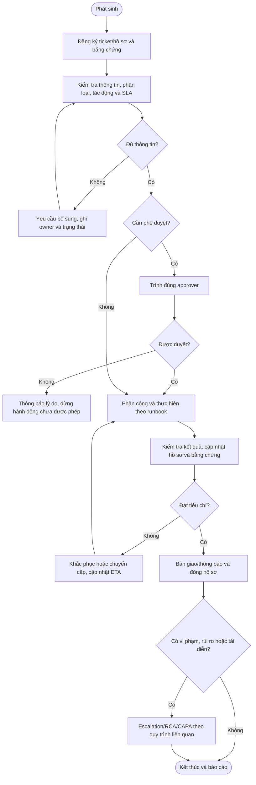

# ITSM-HR-001 — Nhân viên mới, chuyển vị trí và nghỉ việc

**Trạng thái:** DRAFT v1.0 | Owner: HR/Manager + IT | Approver: [CẦN CHỐT]

## Joiner
1. HR/manager tạo ticket với danh tính, bộ phận/role, ngày bắt đầu, site và manager.
2. Manager/owner xác nhận role template, thiết bị, license, email/SSO/VPN/share/app.
3. IT cấp account theo Access Management, MFA khi hỗ trợ, cấu hình endpoint và cài phần mềm được duyệt.
4. Bàn giao thiết bị/phụ kiện và hướng dẫn báo sự cố.
5. Cập nhật ticket/register.

## Mover
1. Nhận thông báo chính thức và ngày hiệu lực.
2. So sánh quyền đang có với role mới.
3. Thu hồi quyền không còn cần; chỉ cấp quyền mới sau approval.
4. Cập nhật tài sản/license/dữ liệu/nhóm.

## Leaver
1. HR/manager xác nhận ngày/giờ hiệu lực và danh sách hệ thống.
2. Khóa/thu hồi account, VPN/SSO/email/SaaS/API token và vendor access đúng thời điểm được duyệt.
3. Thu hồi thiết bị/phụ kiện/license/thẻ và cập nhật Asset Register.
4. Chuyển giao dữ liệu công việc theo approval, không truy cập dữ liệu cá nhân vượt thẩm quyền.
5. Ghi hạng mục chưa xong, owner, deadline và escalation.
6. HR/manager/IT xác nhận checklist.

IT không tự suy đoán thời điểm nghỉ việc; không xóa dữ liệu trước khi xác nhận chính sách lưu giữ/chuyển giao.

## Kiểm soát vận hành chung
- **Trạng thái:** DỰ THẢO — chỉ có hiệu lực sau phê duyệt theo thẩm quyền MSTAR.
- **Phân biệt nội dung:** thông tin trong hồ sơ nguồn là căn cứ hiện có; kiểm soát bổ sung là đề xuất; giá trị thiếu phải được chốt trước ban hành.
- **Vai trò:** requester/đơn vị yêu cầu cung cấp thông tin; Service Desk/IT tiếp nhận và điều phối; process owner chịu trách nhiệm chất lượng; approver quyết định theo ma trận thẩm quyền; IT Lead giám sát ngoại lệ và báo cáo.
- **Bằng chứng:** hồ sơ truy xuất được người yêu cầu, người xử lý, thời điểm, phê duyệt, kết quả và liên kết bằng chứng. Không lưu mật khẩu, token, private key hoặc recovery code trong ticket, CSV, email thông thường hay Git.
- **Chuyển quy trình:** gián đoạn dịch vụ liên kết ITSM-INC-001; dấu hiệu ATTT liên kết ITSM-SEC-001; thay đổi production liên kết ITSM-CHG-001; cấp quyền liên kết ITSM-IAM-001; restore liên kết ITSM-BKP-001.

## Lưu đồ

## Luồng công việc đặc thù — ITSM-HR-001 Vòng đời nhân sự
1. **Kích hoạt:** HR/manager gửi thông báo chính thức.
2. **Tiếp nhận/đánh giá:** Xác minh danh tính, vai trò, site, manager và ngày hiệu lực.
3. **Kiểm soát:** Manager/owner duyệt role, thiết bị, license và quyền.
4. **Thực hiện:** Joiner: cấp theo IAM/Asset; Mover: thu hồi quyền cũ trước cấp mới.
5. **Xác minh/kết thúc:** Leaver: khóa quyền đúng thời điểm, thu hồi tài sản/license.
6. **Ngoại lệ/chuyển cấp:** Đối soát account, asset, data transfer và đóng checklist.
7. **Bằng chứng đặc thù:** HR chưa xác nhận thời điểm, nghỉ việc khẩn cấp, tranh chấp dữ liệu.
8. **KPI đề xuất:** HR ticket, approvals, access logs, asset handover, checklist.

## Hồ sơ, chỉ số và checklist đóng
- **Hồ sơ tối thiểu:** mã tham chiếu, đầu vào, phân loại, SLA nếu áp dụng, phê duyệt nếu cần, người thực hiện, timeline, kết quả kiểm tra, thông báo/bàn giao và bằng chứng.
- **Nơi lưu/thời hạn:** theo kho lưu và chính sách MSTAR được phê duyệt; không tự đặt thời hạn.
- **KPI đề xuất:** chỉ dùng sau khi process owner xác nhận định nghĩa, nguồn dữ liệu, chu kỳ và mục tiêu.
- **Checklist đóng:** [ ] đúng requester/owner; [ ] phê duyệt đầy đủ; [ ] kết quả kiểm tra; [ ] ticket/register cập nhật; [ ] không chứa secret; [ ] bằng chứng truy xuất được; [ ] vi phạm/tái diễn đã escalation/RCA/CAPA.
- **Cần chốt trước ban hành:** owner/approver; ma trận SLA/escalation; ngưỡng kỹ thuật/retention nếu áp dụng; kho hồ sơ/quyền/thời hạn lưu; kết quả kiểm thử quy trình.
