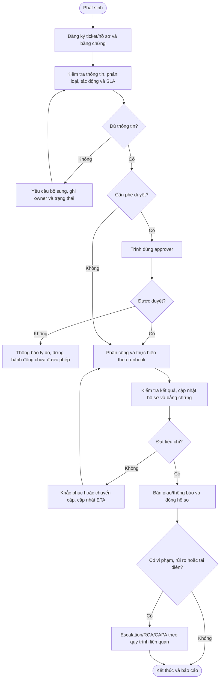

# ITSM-DOC-001 — Kiểm soát tài liệu, sơ đồ và tri thức

**Trạng thái:** DRAFT v1.0 | Owner: IT Lead/Document Owner | Approver: [CẦN CHỐT]

## Metadata
Document ID, title, process, owner, version, status, author/reviewer/approver, effective date, review date, canonical location và change history.

## Quy trình
1. Xác định owner và lý do tạo/sửa.
2. Rà soát tài liệu liên quan.
3. Người chuyên môn kiểm tra; owner/approver phê duyệt trước khi chuyển Approved.
4. Phát hành bản chính tại kho có phân quyền và thông báo người dùng liên quan.
5. Lưu phiên bản cũ để truy vết; đánh dấu Obsolete để tránh nhầm.
6. Sau incident/change/restore test, cập nhật runbook, sơ đồ, knowledge, inventory và tài liệu liên quan.

## Sơ đồ as-built
Theo site cần thể hiện WAN/ISP, router/firewall, switch, VLAN/IP/subnet, Wi-Fi, server/NAS, camera/phone/printer, VPN, phụ thuộc, owner và ngày cập nhật. Network Diagram Template cũ chỉ là sơ đồ mẫu đến khi được đối chiếu thực tế.

Không lưu password/private key/token trong sơ đồ hoặc repository. Review theo lịch được duyệt và sau thay đổi quan trọng.

## Kiểm soát vận hành chung
- **Trạng thái:** DỰ THẢO — chỉ có hiệu lực sau phê duyệt theo thẩm quyền MSTAR.
- **Phân biệt nội dung:** thông tin trong hồ sơ nguồn là căn cứ hiện có; kiểm soát bổ sung là đề xuất; giá trị thiếu phải được chốt trước ban hành.
- **Vai trò:** requester/đơn vị yêu cầu cung cấp thông tin; Service Desk/IT tiếp nhận và điều phối; process owner chịu trách nhiệm chất lượng; approver quyết định theo ma trận thẩm quyền; IT Lead giám sát ngoại lệ và báo cáo.
- **Bằng chứng:** hồ sơ truy xuất được người yêu cầu, người xử lý, thời điểm, phê duyệt, kết quả và liên kết bằng chứng. Không lưu mật khẩu, token, private key hoặc recovery code trong ticket, CSV, email thông thường hay Git.
- **Chuyển quy trình:** gián đoạn dịch vụ liên kết ITSM-INC-001; dấu hiệu ATTT liên kết ITSM-SEC-001; thay đổi production liên kết ITSM-CHG-001; cấp quyền liên kết ITSM-IAM-001; restore liên kết ITSM-BKP-001.

## Lưu đồ

## Luồng công việc đặc thù — ITSM-DOC-001 Kiểm soát tài liệu
1. **Kích hoạt:** Tạo mới/sửa/rà soát/thu hồi tài liệu.
2. **Tiếp nhận/đánh giá:** Gán mã, owner, version, status, reviewer/approver và ngày hiệu lực.
3. **Kiểm soát:** Rà soát tác động, link, tài liệu liên quan và tính đúng/khả thi.
4. **Thực hiện:** Phê duyệt trước khi phát hành; thông báo người dùng.
5. **Xác minh/kết thúc:** Thu hồi bản lỗi thời; cập nhật runbook/sơ đồ sau change/incident.
6. **Ngoại lệ/chuyển cấp:** Lưu history, approval và evidence review.
7. **Bằng chứng đặc thù:** Tài liệu mâu thuẫn, link hỏng, bản lỗi thời đang dùng.
8. **KPI đề xuất:** Document Register, change history, approvals.

## Hồ sơ, chỉ số và checklist đóng
- **Hồ sơ tối thiểu:** mã tham chiếu, đầu vào, phân loại, SLA nếu áp dụng, phê duyệt nếu cần, người thực hiện, timeline, kết quả kiểm tra, thông báo/bàn giao và bằng chứng.
- **Nơi lưu/thời hạn:** theo kho lưu và chính sách MSTAR được phê duyệt; không tự đặt thời hạn.
- **KPI đề xuất:** chỉ dùng sau khi process owner xác nhận định nghĩa, nguồn dữ liệu, chu kỳ và mục tiêu.
- **Checklist đóng:** [ ] đúng requester/owner; [ ] phê duyệt đầy đủ; [ ] kết quả kiểm tra; [ ] ticket/register cập nhật; [ ] không chứa secret; [ ] bằng chứng truy xuất được; [ ] vi phạm/tái diễn đã escalation/RCA/CAPA.
- **Cần chốt trước ban hành:** owner/approver; ma trận SLA/escalation; ngưỡng kỹ thuật/retention nếu áp dụng; kho hồ sơ/quyền/thời hạn lưu; kết quả kiểm thử quy trình.
